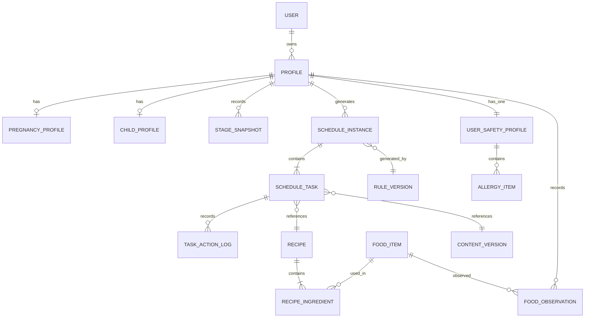

# 02-data-model.md

# 食刻 — 一期数据模型 Spec

| 文档属性     | 内容                                           |
| ------------ | ---------------------------------------------- |
| 项目名称     | 食刻（孕期与婴幼儿餐食日程助手）               |
| 文档名称     | 一期数据模型 Spec                              |
| 文件路径     | `specs/02-data-model.md`                       |
| 版本         | V1.0                                           |
| 状态         | Draft                                          |
| 对应 PRD     | PRD V1.2                                       |
| 业务依据     | `specs/01-business-flow.md`                    |
| 技术方向     | 微信小程序原生框架 + 微信云开发                |
| 一期目标用户 | 孕 30 周左右孕晚期用户、2 岁左右幼儿主要照护者 |

---

## 1. 文档目的

本文档定义「食刻」一期核心业务数据模型，作为数据库设计、云函数接口、业务规则引擎和内容管理工具的共同依据。

本文档重点解决：

1. 用户与档案之间的数据关系。
2. 孕期与幼儿领域数据如何分别建模。
3. 阶段信息如何保存及追踪。
4. 食谱、食材及内容版本如何管理。
5. 日程实例与任务实例如何关联。
6. 过敏状态、禁忌清单和新食物观察记录如何管理。
7. 用户操作历史如何保存。
8. 安全规则及日程生成结果如何追溯。
9. 如何为后续扩展孕期及 0—36 月龄完整业务预留能力。

### 1.1 设计原则

**原则一：业务实体优先。**

数据模型应反映真实业务概念，不应仅根据页面结构设计数据库表或集合。

**原则二：共享基础能力，保留领域差异。**

孕期和幼儿共享用户、档案、日程、任务等基础能力，但各自保留独立领域数据。

**原则三：内容数据化，规则配置化。**

食谱、食材、适用阶段等作为内容数据管理；阶段识别、安全过滤和日程生成作为业务规则处理。

**原则四：重要状态可追溯。**

过敏信息修改、任务替换、日程调整、内容版本变化等操作必须保留必要历史记录。

**原则五：安全约束不可绕过。**

用户偏好、手动选择和任务替换不能覆盖安全规则。

**原则六：允许信息缺失。**

非必要信息允许为空或暂不设置。不得为了满足数据库字段完整性而强制用户填写不必要的信息。

**原则七：一期可实现，后续可扩展。**

不为尚未确定的复杂业务提前设计大量抽象层，但应避免一期数据结构阻碍后续阶段扩展。

---

## 2. 数据模型整体架构

### 2.1 领域划分

建议划分为六个业务域：

| 业务域       | 主要实体                                                 | 职责                         |
| ------------ | -------------------------------------------------------- | ---------------------------- |
| 用户与档案域 | User、Profile                                            | 用户身份及业务档案           |
| 阶段管理域   | PregnancyProfile、ChildProfile、StageSnapshot            | 孕期及幼儿阶段识别           |
| 内容管理域   | FoodItem、Recipe、RecipeIngredient                       | 食材及食谱内容               |
| 日程执行域   | ScheduleInstance、ScheduleTask、TaskActionLog            | 日程生成及执行               |
| 安全管理域   | UserSafetyProfile、AllergyItem、FoodObservation、FoodAllergen、FoodSafetyProfile、RecipeSafetyProfile、SafetyRule（`AllergyProfile` 为 §7.1 历史逻辑别名，非独立实体） | 过敏约束、观察记录及安全规则 |
| 系统追溯域   | RuleVersion、ContentVersion、BusinessEvent               | 规则、内容版本及业务事件     |

### 2.2 实体关系总览



说明：

- 上图描述逻辑关系，不代表数据库必须采用关系型数据库。
- 微信云数据库可以通过集合及引用 ID 实现。
- `Profile` 是业务档案的统一入口。
- `PregnancyProfile` 和 `ChildProfile` 分别保存领域特有信息。
- 日程及任务必须关联生成时使用的内容版本和规则版本。
- 每个 `Profile` 至多一条 `UserSafetyProfile`（孕期与幼儿档案均适用）；已知过敏明细经 `AllergyItem` 关联同一 `profileId` / `userSafetyProfileId`。
- `FoodObservation` 通过 `profileId` 归属业务档案（一期主要用于幼儿新食物观察），不能仅关联用户账号。

### 2.3 一期实体清单

| 实体             | 是否一期必须 | 说明               |
| ---------------- | ------------ | ------------------ |
| User             | 是           | 用户基础信息       |
| Profile          | 是           | 统一档案           |
| PregnancyProfile | 是           | 孕期领域信息       |
| ChildProfile     | 是           | 幼儿领域信息       |
| StageSnapshot    | 是           | 阶段识别历史       |
| FoodItem         | 是           | 标准食材           |
| Recipe           | 是           | 标准食谱           |
| RecipeIngredient | 是           | 食谱食材及用量关系 |
| ScheduleInstance | 是           | 日程实例           |
| ScheduleTask     | 是           | 日程任务           |
| TaskActionLog    | 是           | 任务操作历史       |
| UserSafetyProfile | 是        | 每档案用户安全档案（过敏状态权威存储；`AllergyProfile` 仅为 §7.1 逻辑别名，非独立持久化实体） |
| AllergyItem      | 是           | 已知过敏食物清单（05 逻辑名 `AllergyRestriction`）   |
| FoodObservation  | 是           | 新食物观察记录     |
| FoodAllergen     | 是           | 过敏原字典（`food_allergens`） |
| FoodSafetyProfile | 是        | 食材侧已审核安全属性（可后台维护） |
| RecipeSafetyProfile | 是      | 食谱侧已审核安全属性 |
| AllergyChangeLog | 是           | 过敏状态与禁忌变更审计（追加写入） |
| SafetyRule       | 是           | 安全规则           |
| RuleVersion      | 是           | 规则版本           |
| ContentVersion   | 是           | 内容版本           |
| BusinessEvent    | 是           | 业务事件           |

注：部分实体在一期可以由受控后台或初始化数据维护，不要求全部建设成独立管理页面。

---

## 3. 用户与档案模型

### 3.1 User 用户实体

用途：表示微信小程序用户身份。

建议字段：

| 字段           | 类型     | 必填 | 说明         |
| -------------- | -------- | ---- | ------------ |
| `_id`          | string   | 是   | 用户唯一 ID  |
| `openid`       | string   | 是   | 微信用户标识 |
| `status`       | string   | 是   | 用户状态     |
| `createdAt`    | datetime | 是   | 创建时间     |
| `updatedAt`    | datetime | 是   | 更新时间     |
| `lastActiveAt` | datetime | 否   | 最近活跃时间 |

状态：

| 状态 | 标识       | 说明         |
| ---- | ---------- | ------------ |
| 正常 | `active`   | 正常使用     |
| 停用 | `disabled` | 禁止继续使用 |

约束：

1. `openid` 必须唯一。
2. 不应将微信身份信息和业务档案混合存储。
3. 不在 User 中直接保存孕周、出生日期、过敏清单等领域数据。
4. 用户删除或停用涉及的具体数据处理，应遵循后续隐私与数据生命周期规范。

### 3.2 Profile 统一档案实体

用途：表示用户创建的一个业务档案。

一个 User 可以拥有多个 Profile。

一期允许简化档案切换交互，但底层必须支持多档案。

建议字段：

| 字段                  | 类型     | 必填 | 说明             |
| --------------------- | -------- | ---- | ---------------- |
| `_id`                 | string   | 是   | 档案唯一 ID      |
| `userId`              | string   | 是   | 所属用户 ID      |
| `profileType`         | string   | 是   | 档案类型         |
| `displayName`         | string   | 否   | 档案展示名称     |
| `status`              | string   | 是   | 档案状态         |
| `currentStageCode`    | string   | 否   | 当前阶段编码     |
| `currentStageVersion` | string   | 否   | 当前阶段规则版本 |
| `createdAt`           | datetime | 是   | 创建时间         |
| `updatedAt`           | datetime | 是   | 更新时间         |
| `archivedAt`          | datetime | 否   | 归档时间         |

`profileType`：

- `pregnancy`
- `child`

`status`：

- `draft`
- `active`
- `paused`
- `archived`

约束：

1. `userId` 必须关联有效 User。
2. `profileType` 创建后原则上不可直接修改。
3. 孕期档案必须关联 PregnancyProfile。
4. 幼儿档案必须关联 ChildProfile。
5. 档案归档不等于物理删除。
6. 不同档案的数据必须严格隔离。
7. 查询和写入业务数据时，必须校验当前用户是否拥有该档案。

### 3.3 PregnancyProfile 孕期领域实体

用途：保存孕期特有信息。

建议字段：

| 字段                    | 类型     | 必填     | 说明               |
| ----------------------- | -------- | -------- | ------------------ |
| `_id`                   | string   | 是       | 领域记录 ID        |
| `profileId`             | string   | 是       | 关联 Profile       |
| `dueDate`               | date     | 条件必填 | 预产期             |
| `gestationalAgeWeeks`   | number   | 否       | 最近计算孕周       |
| `gestationalAgeDays`    | number   | 否       | 孕周内天数         |
| `dateCalculationSource` | string   | 否       | 日期信息来源       |
| `dietPreferences`       | array    | 否       | 饮食偏好           |
| `dietRestrictions`      | array    | 否       | 已知饮食约束       |
| `specialConditions`     | array    | 否       | 用户声明的特殊情况 |
| `createdAt`             | datetime | 是       | 创建时间           |
| `updatedAt`             | datetime | 是       | 更新时间           |

说明：

1. 预产期及孕周相关字段需要明确日期计算口径。
2. `gestationalAgeWeeks` 和 `gestationalAgeDays` 是计算结果，不应作为唯一事实来源。
3. 用户修改日期信息后，需要重新计算阶段。
4. `dateCalculationSource` 应记录日期来源，例如用户填写或其他经确认的数据来源。
5. 特殊情况属于用户声明，不代表系统进行医学诊断。
6. 未经专业审核的特殊情况不能直接形成自动推荐规则。

建议 `dateCalculationSource` 枚举：

- `user_input`
- `professional_record`
- `other`

具体是否支持其他来源，需要在产品流程中确认。

### 3.4 ChildProfile 幼儿领域实体

用途：保存幼儿特有信息。

建议字段：

| 字段               | 类型     | 必填 | 说明         |
| ------------------ | -------- | ---- | ------------ |
| `_id`              | string   | 是   | 领域记录 ID  |
| `profileId`        | string   | 是   | 关联 Profile |
| `birthDate`        | date     | 是   | 出生日期     |
| `ageMonths`        | number   | 否   | 最近计算月龄 |
| `ageDays`          | number   | 否   | 月龄内天数   |
| `dietPreferences`  | array    | 否   | 饮食偏好     |
| `dietRestrictions` | array    | 否   | 已知饮食约束 |
| `feedingNotes`     | string   | 否   | 其他喂养说明 |
| `createdAt`        | datetime | 是   | 创建时间     |
| `updatedAt`        | datetime | 是   | 更新时间     |

约束：

1. 出生日期是年龄计算的基础数据。
2. `ageMonths` 和 `ageDays` 是计算结果，不应作为唯一事实来源。
3. 月龄计算必须采用明确的日期口径。
4. 不得简单将出生天数除以 30 得出月龄。
5. 幼儿年龄变化时，需要重新执行阶段识别。
6. 不将照护者填写的普通说明自动识别为医学诊断。

### 3.5 Profile 与领域实体关系

```text
User
  |
  +---- Profile (pregnancy)
  |          |
  |          +---- PregnancyProfile
  |
  +---- Profile (child)
             |
             +---- ChildProfile
```

设计要求：

- `Profile` 负责统一档案管理。
- `PregnancyProfile` 只保存孕期领域信息。
- `ChildProfile` 只保存幼儿领域信息。
- 不建议把所有领域字段全部堆放在 Profile 中。
- 业务代码通过 `profileType` 分发到对应领域服务。

---

## 4. 阶段管理模型

### 4.1 StageSnapshot 阶段快照

用途：记录档案在某一时刻识别出的阶段信息。

建议字段：

| 字段                 | 类型     | 必填 | 说明         |
| -------------------- | -------- | ---- | ------------ |
| `_id`                | string   | 是   | 记录 ID      |
| `profileId`          | string   | 是   | 档案 ID      |
| `profileType`        | string   | 是   | 档案类型     |
| `stageCode`          | string   | 是   | 阶段编码     |
| `stageName`          | string   | 是   | 阶段名称     |
| `stageStartAt`       | date     | 否   | 阶段起始时间 |
| `stageEndAt`         | date     | 否   | 阶段结束时间 |
| `calculatedAt`       | datetime | 是   | 计算时间     |
| `sourceDataSnapshot` | object   | 是   | 计算依据快照 |
| `stageRuleVersion`   | string   | 是   | 阶段规则版本 |
| `isCurrent`          | boolean  | 是   | 是否当前阶段 |

用途：

- 追踪阶段变化。
- 解释某次日程生成时使用的阶段。
- 处理阶段变化后的日程重新校验。
- 支持后续阶段规则调整。

### 4.2 阶段编码

阶段编码应采用可配置方式，不应将所有阶段边界写死在业务代码中。

建议示例：

孕期：

- `pregnancy_late`

幼儿：

- `child_toddler`

以上仅为一期领域编码建议。具体阶段边界、名称和适用范围需要由产品及专业审核确认。

### 4.3 阶段快照约束

1. 每个档案在同一计算时点只能有一个当前阶段。
2. 阶段变化时，保留旧快照。
3. 新快照必须记录规则版本。
4. 日程实例必须记录生成时对应的阶段快照。
5. 阶段变化不能静默覆盖历史日程的生成依据。

---

## 5. 内容模型

### 5.1 内容模型整体关系

```text
FoodItem 食材
    |
    | 1:N
    v
RecipeIngredient 食谱食材关系
    ^
    | N:1
Recipe 食谱
    |
    +---- ContentVersion 内容版本
```

内容管理的核心要求：

- 食材和食谱分开管理。
- 食谱通过 RecipeIngredient 关联多个食材。
- 食谱内容需要支持版本管理。
- 食谱需要明确适用阶段。
- 安全相关标签必须有明确的数据来源和审核记录。
- 不得使用未经核验的营养数据进行精确营养计算。

### 5.1.1 内容生命周期状态（权威枚举）

以下枚举用于 **`Recipe.status`、`FoodItem.status`** 等内容主实体。状态迁移、审核流程及进入生产推荐池条件以 `specs/03-content-spec.md` 第 12 章为准。

| 状态 | 含义 |
| --- | --- |
| `draft` | 草稿，尚未提交审核；AI 生成内容默认仅为此状态 |
| `pending_review` | 已提交审核，等待审核结论 |
| `approved` | 审核通过，尚未正式发布 |
| `published` | 已发布；在满足版本审核与有效期条件下可进入生产候选池 |
| `withdrawn` | 已撤回，禁止进入新的日程候选 |
| `archived` | 已归档，不再参与新业务 |

与主实体 `status` **分开管理**的状态：

| 层级 | 字段 | 用途 |
| --- | --- | --- |
| 内容版本 | `ContentVersion.reviewStatus` | 某一版本快照的审核结论 |
| 营养数据 | `NutritionData.reviewStatus` | 营养数据核验（含 `expired`，见 03 §9.3） |
| 审核流水 | `ContentReviewLog.result` | 单次审核结果（如 `rejected`） |

**过期（expired）**：不是内容主实体的持久化 `status` 值；候选过滤时结合 `ContentVersion.expiresAt`、业务时间及营养数据核验状态动态判断。

**审核驳回**：`ContentReviewLog.result = rejected` 后，主实体回到 `draft`（或待编辑后再次提交），不增加独立的 `rejected` 主状态枚举。

**撤回与归档**：`withdrawn` 自生产池撤回并触发未来未执行任务重校验；`archived` 为归档终态。历史 `ScheduleTask` 仍保留生成时的 `contentVersionId`。

### 5.2 FoodItem 食材实体

用途：维护标准食材信息。

建议字段：

| 字段               | 类型     | 必填 | 说明                   |
| ------------------ | -------- | ---- | ---------------------- |
| `_id`              | string   | 是   | 食材 ID                |
| `name`             | string   | 是   | 食材名称               |
| `aliases`          | array    | 否   | 别名                   |
| `categoryCode`     | string   | 是   | 食材分类               |
| `allergenCodes`    | array    | 否   | 内容侧过敏原分类标签，用于展示与内容检索，**不作为** S1 安全判定依据；权威安全关联由 `FoodSafetyProfile.allergenIds` 管理 |
| `textureTags`      | array    | 否   | 质地标签               |
| `status`           | string   | 是   | 内容生命周期状态，枚举见 §5.1.1 |
| `sourceReferences` | array    | 否   | 来源依据               |
| `createdAt`        | datetime | 是   | 创建时间               |
| `updatedAt`        | datetime | 是   | 更新时间               |

内容审核与别名发布元数据（`reviewStatus`、`reviewedBy`、`reviewedAt`、`version`）以 `specs/03-content-spec.md` §4.2—4.2.1 为准；S1 匹配准入见 05 §5.3.2.4。

`FoodItem.status` 与 `Recipe.status` 使用同一套内容生命周期枚举（§5.1.1）。

说明：

1. `allergenCodes` 不能只根据食材名称自动推断；标签应来自经过审核的食材资料，**仅**服务内容与检索，**不得**替代 `FoodSafetyProfile` 参与 S1。
2. 缺少、为空或未命中 `allergenCodes` **不得**作为候选食物安全的依据；S1 过敏判定 **不得**读取本字段。
3. 食材分类、过敏原分类及质地标签应采用标准字典。
4. 未知信息应允许为空，不得默认填充。
5. 食材基础信息与具体食谱中的使用方式分开管理。

### 5.3 Recipe 食谱实体

用途：维护经过审核的标准食谱。

建议字段：

| 字段                     | 类型     | 必填 | 说明                       |
| ------------------------ | -------- | ---- | -------------------------- |
| `_id`                    | string   | 是   | 食谱 ID                    |
| `recipeCode`             | string   | 是   | 业务唯一编码               |
| `name`                   | string   | 是   | 食谱名称                   |
| `description`            | string   | 否   | 食谱简介                   |
| `mealType`               | string   | 是   | 餐次类型                   |
| `applicableProfileTypes` | array    | 是   | 适用档案类型               |
| `applicableStageCodes`   | array    | 是   | 适用阶段                   |
| `ingredients`            | array    | 否   | 食材关系引用或冗余展示数据 |
| `preparationSteps`       | array    | 否   | 制作步骤                   |
| `nutritionData`          | object   | 否   | 营养数据                   |
| `textureTags`            | array    | 否   | 质地标签                   |
| `difficulty`             | string   | 否   | 制作难度                   |
| `sceneTags`              | array    | 否   | 场景标签                   |
| `status`                 | string   | 是   | 内容生命周期状态，枚举见 §5.1.1 |
| `currentVersionId`       | string   | 是   | 当前发布版本               |
| `createdAt`              | datetime | 是   | 创建时间                   |
| `updatedAt`              | datetime | 是   | 更新时间                   |

`mealType` 建议支持配置：

- `breakfast`
- `lunch`
- `dinner`
- `snack`
- `other`

具体餐次配置以一期日程规则为准。

`status`（与 §5.1.1 一致，此处不再重复释义）：

- `draft`
- `pending_review`
- `approved`
- `published`
- `withdrawn`
- `archived`

业务约束：

1. 只有已审核且已发布的食谱可以进入推荐候选。
2. 被撤回的食谱不能继续进入新日程。
3. 食谱必须明确适用的档案类型和阶段。
4. 幼儿食谱必须具备相应的质地及阶段适配审核信息。
5. 营养数据允许部分缺失。
6. 未经核验的营养数据不得用于精确营养计算。
7. 已发布内容发生重要修改时，应创建新版本，不直接覆盖历史版本。

### 5.4 RecipeIngredient 食谱食材关系

用途：描述一个食谱使用了哪些食材及其用量。

建议字段：

| 字段                | 类型    | 必填 | 说明         |
| ------------------- | ------- | ---- | ------------ |
| `_id`               | string  | 是   | 关系记录 ID  |
| `recipeId`          | string  | 是   | 食谱 ID      |
| `foodItemId`        | string  | 是   | 食材 ID      |
| `quantity`          | number  | 否   | 用量         |
| `unit`              | string  | 否   | 用量单位     |
| `preparationMethod` | string  | 否   | 食材处理方式 |
| `isMainIngredient`  | boolean | 否   | 是否主要食材 |
| `sortOrder`         | number  | 否   | 展示顺序     |

约束：

- 食材必须关联有效 FoodItem。
- 用量和单位必须成对校验。
- 未知用量允许为空。
- 不允许用默认值伪造实际用量。
- 食谱发布时需要校验食材关系完整性。

### 5.5 NutritionData 营养数据

建议采用结构化对象。

字段示例：

| 字段               | 类型          | 说明       |
| ------------------ | ------------- | ---------- |
| `energyKcal`       | number/null   | 能量       |
| `proteinG`         | number/null   | 蛋白质     |
| `fatG`             | number/null   | 脂肪       |
| `carbohydrateG`    | number/null   | 碳水化合物 |
| `fiberG`           | number/null   | 膳食纤维   |
| `sodiumMg`         | number/null   | 钠         |
| `calculationBasis` | string        | 计算依据   |
| `dataSource`       | string        | 数据来源   |
| `verifiedAt`       | datetime/null | 核验时间   |

说明：

1. 上述字段是数据结构建议，不代表一期必须采集全部指标。
2. 未核验的数据应为 null。
3. 必须明确数据对应的份量或计量基准。
4. 不同食谱的营养数据不能在计量基准不一致时直接比较。
5. 一期是否开展营养定量计算，需要在日程规则 Spec 中确认。

### 5.6 ContentVersion 内容版本

用途：保证历史日程引用的食谱内容可追溯。

建议字段：

| 字段            | 类型     | 必填 | 说明         |
| --------------- | -------- | ---- | ------------ |
| `_id`           | string   | 是   | 内容版本 ID  |
| `contentType`   | string   | 是   | 内容类型     |
| `contentId`     | string   | 是   | 原始内容 ID  |
| `version`       | string   | 是   | 版本号       |
| `snapshot`      | object   | 是   | 版本内容快照 |
| `reviewStatus`  | string   | 是   | 审核状态     |
| `reviewerId`    | string   | 否   | 审核人       |
| `reviewedAt`    | datetime | 否   | 审核时间     |
| `effectiveAt`   | datetime | 否   | 生效时间     |
| `expiresAt`     | datetime | 否   | 失效时间     |
| `changeSummary` | string   | 否   | 版本变更说明 |
| `createdAt`     | datetime | 是   | 创建时间     |

约束：

1. 已发布版本不可直接覆盖。
2. 新版本必须重新执行必要审核。
3. 历史日程引用具体版本 ID。
4. 内容撤回时，应记录撤回原因和时间。
5. 内容版本快照需要包含当时的适用阶段、食材及关键安全标签。

---

## 6. 日程与任务模型

### 6.0 逻辑实体与持久化映射（权威）

日程业务逻辑层级以 `specs/04-schedule-rules.md` 第 3 章为准；本节定义其与持久化实体及集合的对应关系。不要求每个逻辑层级单独建库表/集合。

| 逻辑实体 | 业务职责 | 是否持久化 | 对应持久化实体 | 数据库集合（见 06） |
| --- | --- | --- | --- | --- |
| `SchedulePlan` | 某档案一次「未来 7 天」生成请求的规划边界（含 `generationId`、目标日期范围、规则与内容版本上下文） | 否（生成过程对象） | 由同一 `generationId` 关联的多条 `ScheduleInstance` 共同表达 | — |
| `ScheduleDay` | 某一自然日下的日程容器 | 否（逻辑分组） | `ScheduleInstance`（`profileId` + `scheduleDate` 唯一标识一日） | `schedule_instances`（06 中别名 `schedules`） |
| `ScheduleSlot` | 阶段模板定义的餐次/任务槽位（`slotCode`、`mealType` 等） | 否（由模板展开） | 槽位信息落在 `ScheduleTask.slotCode` 等字段 | — |
| `ScheduleInstance` | 某档案在某自然日的一份已生成日程 | 是 | `ScheduleInstance` | `schedule_instances` |
| `ScheduleTask` | 用户可执行的具体任务 | 是 | `ScheduleTask` | `schedule_tasks` |

关联约定：

1. `ScheduleTask.scheduleId` 即所属 `ScheduleInstance._id`（亦称 `scheduleInstanceId`）。
2. `ScheduleTask.slotCode` 必填，用于追溯任务所属业务槽位及幂等键（见 04 §19.1）。
3. `ScheduleInstance.generationId` 将同一批次生成的多日实例关联为一次 `SchedulePlan`。
4. 已完成、已跳过、用户主动替换的任务不得被重新生成覆盖；历史任务保留 `contentVersionId`、`ruleVersionId`（及 04 要求的其他版本字段）。

### 6.1 ScheduleInstance 日程实例

用途：表示某个档案在某一天的一份日程。

建议字段：

| 字段                 | 类型     | 必填 | 说明                   |
| -------------------- | -------- | ---- | ---------------------- |
| `_id`                | string   | 是   | 日程 ID                |
| `profileId`          | string   | 是   | 档案 ID                |
| `profileType`        | string   | 是   | 档案类型               |
| `scheduleDate`       | date     | 是   | 日程日期               |
| `stageSnapshotId`    | string   | 是   | 阶段快照 ID            |
| `status`             | string   | 是   | 日程状态               |
| `generationId`       | string   | 是   | 本次生成批次 ID        |
| `generationSource`   | string   | 是   | 生成来源               |
| `ruleVersionId`      | string   | 是   | 规则版本               |
| `contentVersionRefs` | array    | 是   | 本次生成使用的内容版本 |
| `profileSnapshot`    | object   | 是   | 生成时档案约束快照     |
| `generatedAt`        | datetime | 是   | 生成时间               |
| `updatedAt`          | datetime | 是   | 更新时间               |

`generationSource` 建议：

- `initial`
- `scheduled`
- `regenerated`
- `manual_adjustment`

说明：

1. 一份日程对应一个档案和一个日期。
2. 日程必须记录生成时的阶段及规则版本。
3. 日程生成结果需要可重复追溯。
4. 日程重新生成不能直接覆盖历史操作记录。
5. 一期未来 7 天日程需要通过多个日期的日程实例实现。
6. `profileSnapshot` 只保存生成决策所需的最小必要信息，不复制整个用户档案。

### 6.2 ScheduleTask 日程任务

用途：表示日程中的一个具体执行任务。

建议字段：

| 字段                | 类型     | 必填 | 说明             |
| ------------------- | -------- | ---- | ---------------- |
| `_id`               | string   | 是   | 任务 ID          |
| `scheduleId`        | string   | 是   | 所属日程实例 ID（同 scheduleInstanceId） |
| `profileId`         | string   | 是   | 所属档案 ID      |
| `slotCode`          | string   | 是   | 阶段模板槽位编码 |
| `taskCode`          | string   | 是   | 任务业务编码     |
| `mealType`          | string   | 是   | 餐次类型         |
| `scheduleTemplateVersion` | string | 否 | 生成时日程模板版本 |
| `recipeId`          | string   | 否   | 当前关联食谱 ID  |
| `contentVersionId`  | string   | 否   | 当前食谱版本 ID  |
| `status`            | string   | 是   | 任务状态         |
| `plannedAt`         | datetime | 否   | 计划执行时间     |
| `deferredTo`        | datetime | 否   | 顺延后的执行时间 |
| `completedAt`       | datetime | 否   | 完成时间         |
| `originalRecipeId`  | string   | 否   | 最初推荐食谱     |
| `replacementCount`  | number   | 是   | 替换次数         |
| `safetyCheckStatus` | string   | 是   | 最近安全校验状态 |
| `statusReason`      | string   | 否   | 非 pending 时的细粒度原因码，见 §6.2.1 |
| `createdAt`         | datetime | 是   | 创建时间         |
| `updatedAt`         | datetime | 是   | 更新时间         |

`status`：

- `pending`
- `completed`
- `skipped`
- `replaced`
- `deferred`
- `cancelled`
- `invalidated`

### 6.2.1 任务状态与业务语义映射（权威）

持久化 **`status` 仅使用上列枚举**。`04-schedule-rules.md`、`01-business-flow.md` 中出现的其他名称是 UI 或流程语义，落库时按下表映射，并通过 `statusReason` 保留细节：

| 业务/流程称呼（04 等） | 持久化 `status` | 建议 `statusReason` |
| --- | --- | --- |
| `blocked`（安全/内容阻断，待替换） | `invalidated` | `safety_blocked` |
| `expired`（计划窗口已过且未执行） | `invalidated` 或 `cancelled` | `schedule_expired`（失效）/ 用户放弃用 `cancelled` |
| 规则或阶段变化导致不可用 | `invalidated` | `rule_changed` / `stage_changed` / `content_withdrawn` |

说明：

1. 任务必须关联所属日程和档案。
2. 替换操作必须保留原始推荐内容。
3. 当前食谱版本需要明确记录。
4. 任务安全校验结果需要可追溯。
5. 被失效的任务不能继续作为有效推荐执行。
6. 用户完成任务需要明确操作确认。
7. 不应将页面浏览直接写入完成状态。

### 6.3 TaskActionLog 任务操作历史

用途：记录任务生命周期中的操作。

建议字段：

| 字段               | 类型     | 必填 | 说明        |
| ------------------ | -------- | ---- | ----------- |
| `_id`              | string   | 是   | 操作记录 ID |
| `taskId`           | string   | 是   | 任务 ID     |
| `scheduleId`       | string   | 是   | 日程 ID     |
| `profileId`        | string   | 是   | 档案 ID     |
| `actionType`       | string   | 是   | 操作类型    |
| `previousStatus`   | string   | 否   | 操作前状态  |
| `nextStatus`       | string   | 否   | 操作后状态  |
| `previousRecipeId` | string   | 否   | 操作前食谱  |
| `nextRecipeId`     | string   | 否   | 操作后食谱  |
| `reason`           | string   | 否   | 操作原因    |
| `operatorType`     | string   | 是   | 操作者类型  |
| `createdAt`        | datetime | 是   | 操作时间    |

`actionType` 建议：

- `complete`
- `skip`
- `replace`
- `defer`
- `cancel`
- `invalidate`
- `restore`

`operatorType`：

- `user`
- `system`
- `admin`

约束：

- 操作历史原则上只追加，不直接覆盖。
- 用户操作和系统操作需要区分。
- 替换记录必须包含原始和新食谱 ID。
- 安全规则导致任务失效时，需要记录对应原因。
- 历史记录必须关联正确的档案 ID。

---

## 7. 过敏及新食物观察模型

> 安全判断与过滤流程以 `specs/05-safety-rules.md` 为准。本节为**持久化实体**权威定义；05 中同名概念若未标注为「派生/运行时」，均映射至下表实体。

### 7.0 过敏安全实体与持久化映射（权威）

| 概念 | 实体（02） | 职责 | 集合（06） |
| --- | --- | --- | --- |
| 用户安全档案 | `UserSafetyProfile` | 每个 `Profile` 一条；存储四种 `allergyStatus`、孕期 `declaredRestrictions`、档案级安全版本 | `user_safety_profiles` |
| 已知过敏禁忌项 | `AllergyItem` | 用户声明的已知过敏食物/限制；强制过滤数据源 | `allergy_items` |
| 新食物观察 | `FoodObservation` | 单次尝试与观察记录 | `food_observations` |
| 过敏变更历史 | `AllergyChangeLog` | 状态与禁忌清单变更审计 | `allergy_change_logs` |
| 过敏原字典 | `FoodAllergen` | 标准过敏原及与食材的审核映射 | `food_allergens` |
| 食材安全属性 | `FoodSafetyProfile` | 食材侧审核后的安全标签（非用户声明） | `food_safety_profiles` |
| 食谱安全属性 | `RecipeSafetyProfile` | 食谱/版本侧安全审核摘要 | `recipe_safety_profiles` |
| 安全规则 | `SafetyRule` / `RuleVersion` | 可执行规则及发布版本 | `safety_rules` / `safety_rule_versions` |

**与 05 逻辑命名的映射**：

- `UserSafetyProfile`（05 §5.2）→ 本表 `UserSafetyProfile`。
- `AllergyRestriction`（05 §5.3）→ 持久化为 `AllergyItem`；05 名称为规则层别名。
- `FoodAllergen`、`FoodSafetyProfile`、`RecipeSafetyProfile`（05 §5.4—5.6）→ 上表实体；过滤时只读已审核发布数据。

**四种过敏状态存储归属**：仅存于 `UserSafetyProfile.allergyStatus`（枚举见 §7.0.1）。

**集合决议（已采纳）**：一期**仅**使用集合 `user_safety_profiles` 存储 `UserSafetyProfile`。**不再**新建或读写 `allergy_profiles` 集合。文档中的 `AllergyProfile` 指同一数据的**逻辑别名**（多指幼儿档案场景），不是第二个持久化实体。

**业务域**：孕期与幼儿共用 `UserSafetyProfile`；幼儿已知过敏明细用 `AllergyItem`，观察用 `FoodObservation`。孕期额外限制用 `declaredRestrictions`（结构见 §7.0.3，SAF-08 已采纳一期方案）。

### 7.0.1 UserSafetyProfile 用户安全档案

用途：每个业务档案一条，承载用户声明的过敏信息状态及档案级安全版本。

建议字段：

| 字段 | 类型 | 必填 | 说明 |
| --- | --- | --- | --- |
| `_id` | string | 是 | 安全档案 ID |
| `profileId` | string | 是 | 对应 Profile |
| `profileType` | string | 是 | `pregnancy` / `child` |
| `allergyStatus` | string | 是 | 四种状态，见下文 |
| `declaredRestrictions` | array | 否 | 用户声明的额外限制项，元素结构见 §7.0.3 |
| `informationSource` | string | 否 | 信息来源；建议：`user_declaration` / `professional_record` / `other` |
| `declaredAt` | datetime | 否 | 用户首次完成过敏信息声明的时间（可选） |
| `version` | number | 是 | 安全档案版本（变更后递增） |
| `updatedAt` | datetime | 是 | 更新时间 |
| `updatedBy` | string | 是 | 修改来源 |

`allergyStatus` 取值与语义：

- `none_known`：用户声明目前没有已知食物过敏（不等于医学排除所有过敏）。
- `confirmed_allergy`：存在需按禁忌处理的已知过敏声明（不等于产品侧医学诊断）。
- `observing`：存在新食物观察行为；不代表医学上确诊或排除过敏。
- `skipped`：用户暂时不设置过敏信息；不得与 `none_known` 混用，不得自动转换为 `none_known`。

说明：

1. 具体过敏食物由 `AllergyItem` 保存；观察明细由 `FoodObservation` 保存。
2. 用户修改 `allergyStatus` 时应写入 `AllergyChangeLog`（§7.4），保留历史。
3. `skipped` 不阻塞建档与基础日程（见 05）。
4. 若涉及专业记录，`informationSource` 应能表达来源类型；不应默认要求用户上传完整医疗资料。

**与 `AllergyItem.status` 的职责分离（F-04.2，与 04 §9.2—9.3、05 §5.3.1 一致）**：

1. `allergyStatus` 仅表达用户整体过敏信息的填写、认知或观察状态（如是否处于观察流程、是否暂时跳过设置），**不**决定某一条 `AllergyItem` 是否参与 S1 硬过滤。
2. S1 有效禁忌集合**唯一**由 `AllergyItem.profileId` + `status=active` 定义；与 `allergyStatus` 取值无关。
3. 将 `allergyStatus` 改为 `none_known`、`skipped`、`observing` 或 `confirmed_allergy` **不得**自动把已有 `AllergyItem` 置为 `inactive`。
4. 用户 `skipped` 或 `none_known` **不得**作为忽略已存在 `status=active` 禁忌项的理由。
5. 仅当用户对具体 `AllergyItem` 完成明确解除流程（`status` → `inactive`，见 §7.2、05 §5.3.3）后，该条限制才退出 S1。

约束：

1. 一个 `Profile` 对应一条 `UserSafetyProfile`。
2. 修改 `allergyStatus` 或有效 `AllergyItem` 后必须触发未来未执行 `ScheduleTask` 重新校验（见 05）；**已执行**历史任务不得追溯改写。
3. `skipped` 不阻塞建档与基础日程；不得与 `none_known` 混用。

### 7.0.2 FoodAllergen / FoodSafetyProfile / RecipeSafetyProfile

`FoodAllergen`：过敏原字典，字段结构见 `03-content-spec.md` §4.4 及 05 §5.4，持久化集合 `food_allergens`。

`FoodSafetyProfile`、`RecipeSafetyProfile`：内容侧安全属性，结构与 05 §5.5—5.6 一致；可与 `ContentVersion` 快照冗余，但生产过滤以已审核发布记录为准。

**S1 匹配用安全数据（F-04.3-01，与 05 §5.3.2.1 一致）**：

1. 候选 `FoodItem` 须 `status=published`，且存在 `FoodSafetyProfile`（`foodItemId`）且 `reviewStatus` 为 `approved`/`published`，方可在过敏原关联路径上视为数据完整。
2. `FoodSafetyProfile.allergenIds` 为空数组且已满足上条 → 表示**已审核确认**当前无已知关联过敏原；**无** `FoodSafetyProfile` 记录 ≠ 无过敏原。
3. 食谱/复合候选须 `RecipeSafetyProfile.ingredientCompleteness=complete` 且已审核发布，方可对展开成分做 `not_matched` 结论。
4. `FoodItem.allergenCodes` 为内容标签，**不参与** S1 匹配判定；**不能**单独替代 `FoodSafetyProfile` 用于 S1 `not_matched` 门禁（05 §5.3.2.1 **F**）。

### 7.0.3 DeclaredRestriction 孕期/档案级声明限制（SAF-08 已采纳）

用途：存储用户从**经专业审核后发布**的限制字典中选择的声明项；不是医学诊断结果，也不替代 `SafetyRule` 硬过滤。

建议元素结构（`UserSafetyProfile.declaredRestrictions[]`）：

| 字段 | 类型 | 必填 | 说明 |
| --- | --- | --- | --- |
| `restrictionCode` | string | 是 | 引用后台「孕期限制字典」或已发布 `SafetyRule.ruleCode` |
| `restrictionType` | string | 是 | `food_avoid` / `category_avoid` / `preparation_limit` / `other_note` |
| `foodItemId` | string | 否 | 当类型为食物回避时关联标准食材 |
| `freeTextNote` | string | 否 | 仅 `other_note` 时使用；**不得单独触发自动硬过滤** |
| `status` | string | 是 | `active` / `inactive` |
| `declaredAt` | datetime | 是 | 用户声明时间 |
| `source` | string | 是 | `user_declaration` / `professional_record` |

**一期产品边界（已采纳）**：

1. 具体有哪些 `restrictionCode` 由专业人员在后台维护并随 `SafetyRule` 发布，**不在 Spec 中固化医学禁忌清单**。
2. 用户声明步骤为**可选**；未填写不影响建档与未来 7 天日程生成（与过敏 `skipped` 同理，但不混用状态）。
3. 参与 L0 自动过滤的声明：`status=active` 且 `restrictionCode` 对应规则已发布且生效。
4. `freeTextNote` 仅展示与审计，供专业人员后续处理，不进入自动推荐算法。

### 7.1 AllergyProfile（历史逻辑别名，非持久化实体）

`AllergyProfile` **不是**独立持久化实体，**不得**创建或读写 `allergy_profiles` 集合。历史文档、接口或口语中的该名称均指与 `Profile` 一一对应的 **`UserSafetyProfile`**（同 `profileId`）。

| 历史/逻辑名 | 规范实体与字段 | 处理方式 |
| --- | --- | --- |
| `AllergyProfile` 整体 | `UserSafetyProfile` | 读写均走 `user_safety_profiles` |
| `status` | `UserSafetyProfile.allergyStatus` | 同义，权威字段见 §7.0.1 |
| `informationSource` | `UserSafetyProfile.informationSource` | 同义 |
| `declaredAt` | `UserSafetyProfile.declaredAt` | 同义（可选） |
| `updatedAt` / `updatedBy` | `UserSafetyProfile.updatedAt` / `updatedBy` | 同义 |
| 已知过敏明细 | `AllergyItem` | 不得嵌入档案头重复存储 |
| 观察记录 | `FoodObservation` | 独立集合，见 §7.3 |

**禁止**：为 `AllergyProfile` 单独维护第二套字段表或集合；实现层不得双写 `allergy_profiles` 与 `user_safety_profiles`。

### 7.2 AllergyItem 已知过敏食物

用途：保存用户声明的已知过敏食物及对应信息（**对应 05 §5.3 中的 `AllergyRestriction` 逻辑名**；持久化仅此实体）。

**05 `AllergyRestriction` → `AllergyItem` 字段映射**：

| 05 逻辑字段 | 02 规范字段 | 处理方式 | 说明 |
| --- | --- | --- | --- |
| `restrictionId` | `_id` | `MAPPED` | 禁忌记录主键 |
| `profileId` | `profileId` | `RETAINED` | 业务档案 |
| `foodItemId` | `foodItemId` | `RETAINED` | 标准食材（条件必填） |
| `allergenId` | `allergenId` | `RETAINED` | 关联 `FoodAllergen`（可选） |
| `restrictionType` | — | `DECISION_REQUIRED` | V1 **仅**支持食物级禁忌（`foodItemId` / `allergenId` / `foodName`）；食材类别级限制不得视为一期已支持能力 |
| `declarationSource` | `source` | `MAPPED` | 信息**来源**（谁提供/从哪录入）；与 `declarationType` 不可互替 |
| `declarationType` | `declarationType` | `MAPPED` | 声明/确认**性质**（用户声明 vs 专业确认）；不决定限制是否生效 |
| `foodName` | `foodName` | `MAPPED` | 用户可见食物名；无 `foodItemId` 时用于展示与 S1 文本级匹配（见 05 §5.3.1—5.3.2） |
| `evidenceReference` | `evidenceReference` | `MAPPED`（可选） | 依据引用，非医学诊断结论 |
| `status` | `status` | `MAPPED` | **限制是否生效**（硬过滤开关）；仅 `active` / `inactive` |
| `reviewStatus` | `reviewStatus` | `MAPPED` | **专业复核进度**；与限制是否生效分离；见下方枚举 |
| `declaredAt` | `createdAt` | `MAPPED` | 首次声明时间以创建时间为准；更新见 `updatedAt` |
| `updatedAt` | `updatedAt` | `MAPPED` | |
| `notes` | `notes` | `MAPPED` | 用户补充说明 |
| `userSafetyProfileId` | `userSafetyProfileId` | `MAPPED` | 关联 `UserSafetyProfile._id`（05 逻辑层未单列时由实现读取） |

建议字段：

| 字段               | 类型     | 必填     | 说明            |
| ------------------ | -------- | -------- | --------------- |
| `_id`              | string   | 是       | 记录 ID         |
| `profileId`        | string   | 是       | 业务档案 ID     |
| `userSafetyProfileId` | string | 是    | 对应 `UserSafetyProfile._id` |
| `foodItemId`       | string   | 条件必填 | 标准食材 ID     |
| `foodName`         | string   | 条件必填 | 食物名称        |
| `allergenId`       | string   | 否       | 标准过敏原 ID（`FoodAllergen`） |
| `declarationType`  | string   | 是       | 声明/确认性质（见下文）；默认 `user_reported` |
| `source`           | string   | 否       | 信息来源（对应 05 `declarationSource`）；建议：`user_declaration` / `professional_record` / `other` |
| `evidenceReference` | string  | 否       | 可选依据引用    |
| `status`           | string   | 是       | 限制是否生效；默认 `active` |
| `reviewStatus`     | string   | 是       | 专业复核状态；默认 `not_required` |
| `notes`            | string   | 否       | 补充说明        |
| `createdAt`        | datetime | 是       | 创建时间        |
| `updatedAt`        | datetime | 是       | 更新时间        |

> 历史字段名 `allergyProfileId` 已废弃，统一为 `userSafetyProfileId`。

`declarationType`（声明/确认性质，**不**参与「是否硬过滤」判断）：

- `user_reported`：用户主动声明的已知过敏/需回避食物。
- `professionally_confirmed`：专业人员依据记录确认；**不得**由系统将 `user_reported` 自动升级为此值。

`source` / `declarationSource`（信息来源，**不**等同于 `declarationType`）：

- 表示记录从何处进入系统（如用户入口、专业人员代录、其他可信渠道）。
- 同一 `user_reported` 可来自 `user_declaration`；专业确认记录通常 `source=professional_record` 且 `declarationType=professionally_confirmed`，但二者字段语义仍须分别维护。

`status`（限制是否生效 — **S1 硬过滤唯一开关**）：

- `active`：用户当前有效的已知禁忌，**立即**参与 S1 硬过滤。
- `inactive`：用户已明确解除或停用的禁忌，**不**参与硬过滤；须保留审计，并触发未执行日程重新校验（见 05 §5.3.1、§14）。

`reviewStatus`（专业复核进度 — **不得**替代 `status` 决定是否硬过滤）：

- `not_required`：映射完整、无需排队专业复核（实现默认，当已绑定可靠 `foodItemId` 或 `allergenId` 时可选用）。
- `pending_review`：待专业人员复核映射或记录准确性（如仅有 `foodName`、字典未命中）；**仍须**在 `status=active` 时执行 S1 硬过滤。
- `reviewed`：已完成专业复核；**不改变** `status=active` 时的硬过滤行为。
- `rejected`：专业复核不认可该限制；**仅**更新审核结论，**不得**自动或连带修改 `status`。在 `status` 仍为 `active` 时**继续** S1 硬过滤，直至用户完成明确解除确认并将 `status` 置为 `inactive`（见 05 §5.3.3、SAF-10）。**禁止**专业人员、后台任务或审核自动化仅凭 `reviewStatus=rejected` 将 `status` 改为 `inactive`。

**创建默认值（用户新增已知过敏项）**：

1. `status=active`（用户声明即生效，满足 PRD/05 S1）。
2. `declarationType=user_reported`（除非录入通道已标识专业确认）。
3. `reviewStatus=pending_review` 当无法绑定 `foodItemId`/`allergenId` 且依赖 `foodName` 或映射不确定；否则 `not_required`。

**日程引擎 / 安全规则中心读取（S1）**：

- 查询有效禁忌：`profileId` 匹配且 `status=active`（索引见 §12）。
- 命中逻辑以 05 §5.3.1 为准；`reviewStatus` 任意取值均**不得**跳过上述记录。
- `declarationType` 为 `user_reported` 或 `professionally_confirmed` 时，只要 `status=active` 均硬过滤；区别仅展示、审计与后续专业流程，**不**放宽过滤。

**历史数据兼容**：若存在旧数据 `status=pending_review`，迁移为 `status=active` + `reviewStatus=pending_review`（或复核完成后 `reviewStatus=reviewed`），不得因迁移而短暂放开硬过滤。

**明确问答（与 05 §5.3.1 一致）**：

1. 用户声明已知过敏后是否立即硬过滤？— **是**（`status=active`）。
2. `reviewStatus=pending_review` 时是否仍硬过滤？— **是**（当且仅当 `status=active`）。
3. `professionally_confirmed` 与 `user_reported` 是否影响限制生效？— **否**（仅影响性质标注与流程，生效只看 `status`）。
4. 何时可解除限制？— **仅**用户明确确认后的解除或停用：`status=inactive`（及 05 §5.3.3、SAF-10）；`reviewStatus=rejected` **不是**解除依据；不得 AI 或审核侧自动解除。
5. 停用后是否重新校验未执行日程？— **是**（§7.0.1 约束 2）；已执行历史不得追溯修改。

说明：

- `professionally_confirmed` 只能在有相应专业依据时使用。
- 用户自行声明不能被系统自动升级为专业确认。
- `foodName` 在缺少 `foodItemId` 时保存用户原意并支持 S1 文本级匹配；应尽量补全 `foodItemId` 或 `allergenId`，但**不得**因未映射而忽略声明。
- 类别级 `restrictionType` 一期**未**作为 `AllergyItem` 持久化字段；不得将类别级禁忌伪装为 V1 已上线能力。

停用记录应保留历史，不直接物理删除。

### 7.3 FoodObservation 新食物观察记录

用途：保存幼儿尝试新食物及后续观察信息。

建议字段：

| 字段                  | 类型     | 必填 | 说明         |
| --------------------- | -------- | ---- | ------------ |
| `_id`                 | string   | 是   | 观察记录 ID  |
| `profileId`           | string   | 是   | 业务档案 ID  |
| `foodItemId`          | string   | 否   | 标准食材 ID  |
| `foodName`            | string   | 是   | 食物名称     |
| `attemptedAt`         | datetime | 是   | 尝试时间     |
| `consumptionStatus`   | string   | 是   | 食用情况     |
| `observationStatus`   | string   | 是   | 观察结果     |
| `reactionDescription` | string   | 否   | 反应描述     |
| `reactionOccurredAt`  | datetime | 否   | 反应发生时间 |
| `recordedAt`          | datetime | 是   | 记录时间     |
| `createdAt`           | datetime | 是   | 创建时间     |
| `updatedAt`           | datetime | 是   | 更新时间     |

`consumptionStatus` 建议：

- `consumed`
- `partially_consumed`
- `not_consumed`
- `unknown`

`observationStatus` 建议：

- `no_obvious_reaction_recorded`
- `suspected_reaction`
- `not_observed`
- `unknown`

注意：

`no_obvious_reaction_recorded` 仅表示用户记录中没有发现明显反应，不代表医学上确认不过敏。

业务约束：

1. 一条观察记录对应一次具体尝试。
2. 用户可以补充观察信息。
3. 不允许自动将观察结果转换为医学诊断。
4. 疑似反应记录需要触发相应安全处理。
5. 疑似反应后应停止该食物自动安排。
6. 不自动安排未来再次尝试。
7. 观察记录与已知过敏清单是不同实体，不能互相替代。

### 7.4 过敏信息变更历史

`AllergyChangeLog` 用于记录过敏状态及禁忌清单变化；集合 `allergy_change_logs`（见 §11、06 §10.1.0）。**追加写入**；用户客户端 **不得** 直接创建、修改或删除。

字段：

| 字段             | 类型     | 必填 | 说明        |
| ---------------- | -------- | ---- | ----------- |
| `_id`            | string   | 是   | 记录 ID     |
| `profileId`      | string   | 是   | 业务档案 ID |
| `allergyItemId`  | string   | 条件 | 禁忌项 ID；`changeType` 涉及单条 `AllergyItem` 时必填（如 `allergy_item_deactivated`） |
| `previousStatus` | string   | 否   | 修改前状态（档案级 `allergyStatus` 或禁忌项 `AllergyItem.status`） |
| `nextStatus`     | string   | 是   | 修改后状态  |
| `changeType`     | string   | 是   | 变更类型（如 `allergy_status_change`、`allergy_item_deactivated`、`allergy_item_created`） |
| `changedItems`   | array    | 否   | 涉及的 `AllergyItem._id` 及变更摘要（含变更前后 `status` / `reviewStatus` 快照） |
| `source`         | string   | 是   | 操作来源：`user_action` / `admin_on_behalf_with_user_confirm` / `system_automation` / `content_mutation` 等；**不得**单独使用 `professional_review_reject` 作为将 `status` 置 `inactive` 的来源 |
| `actorId`        | string   | 是   | **实际执行**变更的主体（用户、管理员或服务账号 ID） |
| `initiatedBy`    | string   | 条件 | 发起者 ID；与 `actorId` 不同时必填 |
| `userConfirmationId` | string | 条件 | 用户明确确认凭证 ID（服务端确认流水）；`allergy_item_deactivated` **必填**；**不得**存储敏感原文 |
| `userConfirmationAt` | datetime | 条件 | 用户确认时间；与 `userConfirmationId` 同时必填 |
| `confirmationScope` | object | 条件 | 确认对象（如 `allergyItemId`、确认文案摘要 ID）；须可关联至本次解除 |
| `reason`         | string   | 否   | 非敏感摘要；**不能**替代 `userConfirmationId` |
| `outcome`        | string   | 是   | `success` / `failed` / `rejected` |
| `operationId`    | string   | 条件 | 幂等操作 ID；`changeType=allergy_item_deactivated` **必填**。同一用户解除请求的**重试**须复用原 `operationId`；不同解除操作 **不得**复用已与 `outcome=success` 日志绑定的 `(profileId, allergyItemId, operationId)` 组合（见下文唯一性约束） |
| `revalidationTriggered` | boolean | 否 | 是否在解除成功事务内已持久化日程重校验待处理任务（`true` 表示 Outbox/`BackgroundJob` 已与成功解除同事务创建，**非** Worker 执行完成标志） |
| `revalidationReference` | string | 否 | 与本次解除关联的 `BackgroundJob._id`（02 §7.4.1）；便于与 04 §9.5 追溯；**不得**在日志写入后通过更新 append-only 记录补写 |
| `createdAt`      | datetime | 是   | 记录写入时间    |

**解除限制审计（F-04.2 / F-04.3-07 / F-04.3.1-02）**：

1. 将 `AllergyItem.status` 从 `active` 变为 `inactive` 时 **必须** 与一条 `outcome=success` 的 `AllergyChangeLog` **同一事务提交**（`changeType=allergy_item_deactivated`，`allergyItemId` 与 `changedItems` 一致）；见 06 §8.4。
2. `actorId`、`userConfirmationId`、`userConfirmationAt`、`operationId` 必填；管理员代操作须 `source=admin_on_behalf_with_user_confirm` 且确认凭证可关联至该 `AllergyItem` 与本次解除。
3. **不得**因 `reviewStatus` 变为 `rejected` 而省略用户确认或省略本条日志。
4. 审计缺失、事务未提交、或无法关联具体 `AllergyItem` → **不得**视为解除成功；**禁止**在仅写入 `outcome=success` 日志而 `status` 未更新时对外宣称解除成功。
5. 解除成功时 **必须** 在同一数据库事务内：创建 `outcome=success` 日志、创建 `BackgroundJob`（§7.4.1），并写入 `revalidationTriggered=true` 与 `revalidationReference`（指向该 Job `_id`）。仅影响**未来未执行**任务（§7.0.1、05 §5.3.1）；**不得**追溯修改已执行 `ScheduleTask`。**禁止**在事务提交后通过更新 `AllergyChangeLog` 补写重校验关联字段。
6. **`operationId` 唯一性（F-04.3.2）**：幂等键为 `(profileId, allergyItemId, operationId)`。对 `changeType=allergy_item_deactivated` 且 `outcome=success` 的记录，该三元组 **必须** 由集合 `allergy_change_logs` 上的**唯一索引**（或数据库等效强一致唯一约束）保障；**不得**仅依赖事务外查询。适用范围：同一 `profileId` 下针对同一 `allergyItemId` 的每次**成功**解除审计至多一条 success 日志。
7. **条件更新与并发（F-04.3.2）**：`AllergyItem.status` 的解除 **必须** 采用条件更新（或等效 Compare-And-Set）：过滤条件 **必须** 包含 `status=active`（及 `_id`、`profileId` 等业务主键）。**不得**仅凭事务外读到 `active` 即视为可写。须检查数据库返回的**实际更新影响记录数**：
   - 影响记录数 `= 1`：允许在同一事务内追加 `outcome=success` 日志与重校验 `BackgroundJob`。
   - 影响记录数 `= 0`：**不得**在同一事务内写入 `outcome=success` 日志；须按 §7.4.1 与 06 §8.4 判定为幂等重试、已解除、或并发冲突。
   - 影响记录数 `> 1` 或平台报错：**必须**终止事务并记录错误（数据异常）。
8. **幂等重试（F-04.3.2）** — 相同 `(profileId, allergyItemId, operationId)` 的请求须按下表处理（**不得**仅因查到相同 `operationId` 即断言成功，须校验 `AllergyItem` 最终状态与 success 日志一致）：

| 情况 | 处理要求 |
| --- | --- |
| 首次执行成功 | 返回成功结果（含审计与 Job 引用） |
| 重复请求，原操作已成功 | 返回原操作结果；**不得**重复改 `inactive`、**不得**重复追加 success 日志或重复 Outbox Job |
| 相同 `operationId` 正在执行（无 success 日志、状态可能仍为 `active`） | 返回可识别的处理中状态，或阻塞至首事务提交后再按上行判定；**不得**并发写入第二条 success 日志（唯一索引兜底） |
| 相同 `operationId` 原操作已失败（仅有 `failed`/`rejected` 日志或无 success） | 允许在确认凭证仍有效时重试事务；**不得**伪造已成功 |
| 不同 `operationId` 并发解除同一 `AllergyItem` | **仅一个**请求的条件更新影响记录数可为 `1` 并完成 success 日志；其余请求影响记录数为 `0`，**不得**写入 success 审计 |

9. **失败**：校验失败或事务内任一步骤失败时，可 **独立** 追加 `outcome=failed`/`rejected` 日志（**不得**与 `inactive` 及 `success` 同事务）；`AllergyItem.status` 保持 `active`（或保持解除前状态）。

**历史数据兼容**：F-04.3 之前已存在的日志可缺少 `actorId` / `userConfirmationId`；新解除操作从实施日起须满足上表必填条件。

### 7.4.1 BackgroundJob 后台任务（含过敏解除日程重校验 Outbox）

持久化集合 `background_jobs`（06 §10.1、§14.3）；与 append-only `AllergyChangeLog` 分工：**日志**记录不可变业务审计事实；**Job** 表达异步重校验执行状态，**不得**通过修改历史 `AllergyChangeLog` 更新 Worker 进度。

**过敏解除触发的日程重校验**（`eventType` / `jobType` = `allergy_item_deactivated_schedule_revalidation`）建议字段：

| 字段 | 类型 | 必填 | 说明 |
| --- | --- | --- | --- |
| `_id` | string | 是 | Job ID；写入 `AllergyChangeLog.revalidationReference` |
| `jobType` | string | 是 | 固定 `allergy_item_deactivated_schedule_revalidation`（与 `eventType` 同义时可只存其一） |
| `profileId` | string | 是 | 业务档案 |
| `allergyItemId` | string | 是 | 本次解除的禁忌项 |
| `operationId` | string | 是 | 与成功解除日志相同的幂等操作 ID |
| `idempotencyKey` | string | 是 | 建议 `profileId + allergyItemId + operationId`；**须**唯一索引（见 §12） |
| `status` | string | 是 | `pending` / `processing` / `completed` / `failed` |
| `retryCount` | number | 是 | 已执行尝试次数（含失败）；初始 `0` |
| `nextRetryAt` | datetime | 否 | 下次可领取时间；`failed` 终态后可为空 |
| `lastError` | string | 否 | 最近一次失败摘要（非敏感） |
| `leaseOwner` | string \| null | 是 | **Claim Session ID**（单次成功领取所对应的唯一领取会话 ID，F-04.3.3.1.1）；与 Worker 运行实例 ID **不是**同一概念；未被领取或租约已释放时为 `null` |
| `workerInstanceId` | string \| null | 否 | 当前 `processing` 租约关联的 **Worker 运行实例**标识（诊断、日志、运行实例追踪）；**不得**单独作为某次领取身份或执行权证明；租约释放时须置 `null` |
| `leaseExpiresAt` | datetime \| null | 是 | 当前租约到期时间（**服务端时钟**为权威）；无有效租约时为 `null` |
| `claimVersion` | number | 是 | 该 Job 的领取版本号（**fencing token**，与 Claim Session 绑定）；单调递增；每次**成功领取或重新领取**时在原子 claim 内 +1；**不得**与 `idempotencyKey` 混用 |
| `createdAt` | datetime | 是 | 创建时间（与成功解除同事务） |
| `updatedAt` | datetime | 是 | 更新时间 |
| `completedAt` | datetime | 否 | 重校验流程成功结束时间 |

**租约字段语义（F-04.3.3 / F-04.3.3.1.1）**：

**三种身份（不可互相替代）**：

| 概念 | 字段 / 来源 | 含义 |
| --- | --- | --- |
| Worker 运行实例 | `workerInstanceId`（Job 上可选镜像 + Worker 本地） | 标识**哪台/哪个进程**在跑；同一实例可多次领取同一 Job；**仅**诊断与追踪 |
| 领取会话 | `leaseOwner`（Claim Session ID） | 标识**哪一次成功 claim**；每次成功领取 **必须**生成新的、不可复用的 ID；**不得**用稳定的 `workerInstanceId` 填充 |
| 领取版本 | `claimVersion` | 该 Job 的 fencing token；与**当次** Claim Session 在原子 claim 内绑定；旧会话不得采用新会话的版本 |

1. **`claimVersion` 与 `idempotencyKey` / `operationId` 分工**：`idempotencyKey` 保证 Outbox **至多一条** Job；`operationId` 关联解除审计；**不得**将二者当作 Worker 执行权或租约。执行权校验 **必须**同时使用 Claim Session ID（`leaseOwner`）与 `claimVersion`；**不得**仅校验 `workerInstanceId`。
2. **初始化**：Outbox 同事务创建 Job 时，`status=pending`，`leaseOwner=null`，`workerInstanceId=null`，`leaseExpiresAt=null`，`claimVersion=0`（表示尚未有过成功领取）。
3. **成功领取 / 重新领取**（须与 06 §14.4 原子条件更新一致）：发起 claim **前**在 Worker 侧生成新的 Claim Session ID；**仅当**原子条件更新影响记录数 = 1 时，该 ID 才成为有效领取会话。在**同一**条件更新中：`claimVersion` 递增 1，写入本次 Claim Session ID 至 `leaseOwner`，可选写入当前 `workerInstanceId`（**不得**将 `workerInstanceId` 当作 `leaseOwner`），设置 `leaseExpiresAt = serverNow + leaseDuration`（见 06 §14.4），`status=processing`。Worker 本地 **必须**持久持有执行权三元组 `(jobId, claimSessionId, claimVersion)`（其中 `claimSessionId` 与 Job 上 `leaseOwner` 一致）直至释放或确认失效；**禁止**在暂停恢复时用 Job 上最新的 `leaseOwner` / `claimVersion` 覆盖本地会话三元组。
4. **租约续期**：在保持 `status=processing`、`leaseOwner`（Claim Session ID）与 `claimVersion` 不变的前提下，仅更新 `leaseExpiresAt`（须条件匹配**本次领取会话**与版本，见 06 §14.4）。
5. **过期回收**：当 `status=processing` 且 `leaseExpiresAt <= serverNow` 时，回收 Worker 可将 Job 置回可领取状态：`status=pending`（或 `pending` + `nextRetryAt`，若同时计入重试退避），`leaseOwner=null`，`workerInstanceId=null`，`leaseExpiresAt=null`；**不得**在回收时递减或重置 `claimVersion`（下一成功领取再递增，使旧领取会话持有的 `(leaseOwner, claimVersion)` 永久失效）。
6. **完成（`completed`）**：条件更新成功后，`leaseOwner=null`，`workerInstanceId=null`，`leaseExpiresAt=null`；`claimVersion` **保留**最终值供审计，不再用于写入。
7. **失败终态（`failed`）**：同上清理租约字段；保留 `claimVersion` 终值。
8. **可恢复失败退避（`processing` → `pending`）**：须在仍持有**本次 Claim Session** 有效租约时由当前执行流程发起；释放租约（`leaseOwner=null`，`workerInstanceId=null`，`leaseExpiresAt=null`）并写入 `nextRetryAt`；**不得**在未验证 Claim Session + `claimVersion` 的情况下回退状态。
9. **人工恢复**（06 §14.4）：将 `failed` 置 `pending` 时，须清空租约字段（含 `workerInstanceId`）；若 Job 曾处于 `processing` 僵死态，须先按过期回收规则释放再置 `pending`；`claimVersion` 不在人工恢复时重置（下次领取继续递增并生成**新** Claim Session ID）。

**状态转换（本 Job 类型）**：

- `pending` → `processing`：Worker **原子**条件领取成功；`claimVersion` 递增；写入租约。
- `processing` → `processing`：租约续期（仅 `leaseExpiresAt` 变化）或同态无-op 校验失败。
- `processing` → `completed`：当前租约持有者完成重校验；释放租约。
- `processing` → `pending`（或带 `nextRetryAt` 的待重试）：**当前租约持有者**可恢复失败且未达最大重试次数；或**租约过期回收**后变为可领取（回收须条件更新，见 06 §14.4）。
- `*` → `failed`：超过最大重试次数或不可恢复错误；**须**保留记录供人工排查与重新触发（06 §14.4）；释放租约。

**与解除事务的关系（Transactional Outbox）**：成功解除时 **必须** 在**同一**数据库事务内创建 `status=pending` 的上述 Job（含租约字段初始值）；若 Job 创建失败，**不得**单独提交 `inactive` 与 success 日志。

---

## 8. 安全规则及版本模型

### 8.1 SafetyRule 安全规则实体

用途：存储经过审核的安全规则。

建议字段：

| 字段                     | 类型     | 必填 | 说明         |
| ------------------------ | -------- | ---- | ------------ |
| `_id`                    | string   | 是   | 规则 ID      |
| `ruleCode`               | string   | 是   | 规则编码     |
| `ruleType`               | string   | 是   | 规则类型     |
| `severity`               | string   | 是   | 风险等级     |
| `applicableProfileTypes` | array    | 是   | 适用档案类型 |
| `applicableStageCodes`   | array    | 否   | 适用阶段     |
| `condition`              | object   | 是   | 触发条件     |
| `action`                 | object   | 是   | 触发动作     |
| `sourceReferences`       | array    | 是   | 来源依据     |
| `reviewStatus`           | string   | 是   | 审核状态     |
| `ruleVersionId`          | string   | 是   | 规则版本     |
| `effectiveAt`            | datetime | 是   | 生效时间     |
| `expiresAt`              | datetime | 否   | 失效时间     |
| `createdAt`              | datetime | 是   | 创建时间     |
| `updatedAt`              | datetime | 是   | 更新时间     |

建议风险等级：

- `S1`
- `S2`
- `S3`

此分级为产品内部规则管理建议，不代表官方临床风险分级。

规则类型建议：

- `allergy`
- `stage`
- `texture`
- `diet_restriction`
- `special_condition`
- `content_withdrawal`

`reviewStatus`：

- `draft`
- `pending_review`
- `approved`
- `published`
- `withdrawn`

### 8.2 RuleVersion 规则版本

用途：记录规则发布版本。

建议字段：

| 字段            | 类型     | 必填 | 说明        |
| --------------- | -------- | ---- | ----------- |
| `_id`           | string   | 是   | 规则版本 ID |
| `ruleSetCode`   | string   | 是   | 规则集编码  |
| `version`       | string   | 是   | 版本号      |
| `snapshot`      | object   | 是   | 规则快照    |
| `reviewerId`    | string   | 否   | 审核人      |
| `reviewedAt`    | datetime | 否   | 审核时间    |
| `effectiveAt`   | datetime | 是   | 生效时间    |
| `status`        | string   | 是   | 版本状态    |
| `changeSummary` | string   | 否   | 修改说明    |
| `createdAt`     | datetime | 是   | 创建时间    |

约束：

1. 已发布规则版本不可直接覆盖。
2. 规则变更必须生成新版本。
3. 日程实例必须记录生成时使用的规则版本。
4. 规则版本应能够独立回溯。
5. 未审核规则不得参与生产推荐。
6. 规则变更后是否需要重新校验历史未来日程，应根据规则影响范围确定。

---

## 9. 业务事件模型

### 9.1 BusinessEvent

用途：记录一期核心业务行为。

建议字段：

| 字段          | 类型     | 必填 | 说明           |
| ------------- | -------- | ---- | -------------- |
| `_id`         | string   | 是   | 事件 ID        |
| `eventName`   | string   | 是   | 事件名称       |
| `userId`      | string   | 是   | 用户 ID        |
| `profileId`   | string   | 否   | 档案 ID        |
| `profileType` | string   | 否   | 档案类型       |
| `targetId`    | string   | 否   | 业务对象 ID    |
| `targetType`  | string   | 否   | 业务对象类型   |
| `properties`  | object   | 否   | 非敏感事件属性 |
| `occurredAt`  | datetime | 是   | 事件发生时间   |
| `createdAt`   | datetime | 是   | 入库时间       |

一期核心事件：

- `profile_created`
- `schedule_generated`
- `schedule_viewed`
- `task_completed`
- `task_skipped`
- `recipe_replaced`
- `recipe_viewed`
- `schedule_deferred`
- `stage_changed`
- `allergy_status_updated`
- `food_observation_created`
- `safety_rule_triggered`

### 9.2 事件采集约束

1. 事件记录应与核心业务操作区分。
2. 核心业务数据不能只依赖埋点记录。
3. 事件属性遵循最小必要原则。
4. 不在普通分析事件中携带不必要的健康信息。
5. 孕期和幼儿场景应能够独立分析。
6. 事件重复上报需要考虑幂等处理。

---

## 10. 关键实体关系与数据一致性

### 10.1 档案数据隔离

所有档案相关业务数据必须带有 `profileId`。

至少包括：

- 阶段快照。
- 日程实例。
- 日程任务。
- 任务操作记录。
- 过敏信息。
- 已知过敏食物。
- 新食物观察记录。

服务端必须校验：

`profile.userId === currentUser.id`

不能仅依赖客户端传入的 `profileId` 判断数据访问权限。

### 10.2 日程生成一致性

日程生成时需要保存：

- 档案 ID。
- 阶段快照 ID。
- 规则版本 ID。
- 内容版本 ID。
- 档案约束快照。
- 生成批次 ID。
- 生成时间。

以上数据用于回答：

1. 为什么生成这份日程？
2. 生成时用户处于什么阶段？
3. 使用了哪些食谱版本？
4. 执行了哪些规则？
5. 当时有哪些用户约束？

### 10.3 任务操作一致性

任务操作应保证：

1. 状态变更与操作日志保持一致。
2. 替换内容必须通过安全校验。
3. 任务不能在无效状态下继续完成。
4. 同一个操作不能因重复请求而重复产生业务结果。
5. 操作日志保留历史状态及关键内容变化。

### 10.4 过敏信息一致性

过敏信息变更必须：

1. 更新 `UserSafetyProfile`（含 `allergyStatus` 等，见 §7.0.1）。
2. 更新对应 AllergyItem。
3. 记录 AllergyChangeLog。
4. 触发未来未执行任务重新校验。
5. 保存重新校验结果。
6. 无合适替代内容时允许任务暂缺。

### 10.5 内容版本一致性

食谱发布后：

- 新版本不能覆盖旧版本。
- 已生成任务引用具体内容版本。
- 内容撤回后需要重新校验未来未执行任务。
- 历史任务保留生成时内容快照或可访问的不可变版本。

---

## 11. 微信云数据库集合建议

以下是逻辑集合划分建议，不代表必须完全按照此命名落地。

| 集合名称              | 对应实体         | 说明             |
| --------------------- | ---------------- | ---------------- |
| `users`               | User             | 用户             |
| `profiles`            | Profile          | 档案             |
| `pregnancy_profiles`  | PregnancyProfile | 孕期信息         |
| `child_profiles`      | ChildProfile     | 幼儿信息         |
| `stage_snapshots`     | StageSnapshot    | 阶段快照         |
| `food_items`          | FoodItem         | 食材             |
| `recipes`             | Recipe           | 食谱             |
| `recipe_ingredients`  | RecipeIngredient | 食谱食材关系     |
| `content_versions`    | ContentVersion   | 内容版本（含食谱，`contentType=recipe`） |
| `schedule_instances`  | ScheduleInstance | 日程实例         |
| `schedule_tasks`      | ScheduleTask     | 日程任务         |
| `task_action_logs`    | TaskActionLog    | 任务操作记录     |
| `user_safety_profiles`| UserSafetyProfile | 用户安全档案（唯一过敏状态存储） |
| `allergy_items`       | AllergyItem      | 已知过敏食物     |
| `food_allergens`      | FoodAllergen     | 过敏原字典       |
| `food_safety_profiles`| FoodSafetyProfile | 食材安全属性   |
| `recipe_safety_profiles` | RecipeSafetyProfile | 食谱安全属性 |
| `food_observations`   | FoodObservation  | 新食物观察       |
| `allergy_change_logs` | AllergyChangeLog | 过敏信息变更历史 |
| `background_jobs`     | BackgroundJob    | 后台异步任务（含过敏解除日程重校验 Outbox，§7.4.1） |
| `safety_rules`        | SafetyRule       | 安全规则         |
| `safety_rule_versions`| RuleVersion      | 安全规则版本（06 命名） |
| `rule_versions`       | RuleVersion      | 规则版本（与 safety_rule_versions 二选一落地） |
| `business_events`     | BusinessEvent    | 业务事件         |

### 11.1 是否需要拆分集合

不要求所有逻辑实体都必须单独建立集合。

实际实现时应结合：

- 查询模式。
- 数据规模。
- 更新频率。
- 微信云数据库单次查询和事务能力。
- 数据权限要求。
- 规则执行方式。

例如：

- `RecipeIngredient` 可以独立集合，也可以在食谱版本快照中嵌套保存。
- `AllergyItem` 应独立集合或等价独立可读结构；**不得**仅为省集合而嵌入 `UserSafetyProfile` 并丧失按项安全过滤与更新能力。
- `TaskActionLog` 建议独立保存，以便保留操作历史。
- `ContentVersion` 和 `RuleVersion` 建议独立保存，避免发布版本被覆盖。

最终物理集合设计应在技术架构 Spec 中结合实际查询场景确定。

---

## 12. 索引与查询需求

一期至少需要考虑以下查询。

| 集合               | 查询场景             | 建议索引字段                    |
| ------------------ | -------------------- | ------------------------------- |
| users              | 根据微信身份查询用户 | `openid`                        |
| profiles           | 查询用户档案         | `userId + status`               |
| pregnancy_profiles | 根据档案查询孕期信息 | `profileId`                     |
| child_profiles     | 根据档案查询幼儿信息 | `profileId`                     |
| stage_snapshots    | 查询当前阶段         | `profileId + isCurrent`         |
| recipes            | 查询可用食谱         | `status + applicableStageCodes` |
| recipes            | 按类型筛选食谱       | `status + mealType`             |
| schedule_instances | 查询某档案某日程     | `profileId + scheduleDate`      |
| schedule_tasks     | 查询日程任务         | `scheduleId + status`           |
| schedule_tasks     | 查询档案未来任务     | `profileId + plannedAt`         |
| task_action_logs   | 查询任务操作历史     | `taskId + createdAt`            |
| allergy_items      | 查询有效禁忌（S1）   | `profileId + status`（过滤条件 `status=active`） |
| user_safety_profiles | 查询档案安全头     | `profileId`                     |
| food_observations  | 查询观察记录         | `profileId + attemptedAt`       |
| allergy_change_logs | 查询档案变更审计   | `profileId + createdAt`         |
| allergy_change_logs | 按禁忌项追溯         | `allergyItemId + createdAt`     |
| allergy_change_logs | 解除幂等（success） | **唯一索引** `profileId + allergyItemId + operationId`（仅 `changeType=allergy_item_deactivated` 且 `outcome=success`；平台不支持部分唯一索引时须在实现评审中采用等效约束，见 06 §10.4） |
| background_jobs     | 按幂等键去重         | **唯一索引** `idempotencyKey`（至少覆盖 `allergy_item_deactivated_schedule_revalidation`） |
| background_jobs     | Worker 领取待执行    | `status + nextRetryAt`（或 `jobType + status + nextRetryAt`） |
| background_jobs     | 过期租约回收扫描     | `status + leaseExpiresAt`（`status=processing` 且租约已到期） |
| background_jobs     | 租约续期 / 执行权校验 | `_id`（主键条件更新；与 `leaseOwner`（Claim Session ID）、`claimVersion` 组合校验；**不得**仅用 `workerInstanceId`） |
| safety_rules       | 查询有效安全规则     | `reviewStatus + effectiveAt`    |
| content_versions   | 查询内容版本         | `contentId + version`           |
| business_events    | 按档案及时间统计     | `profileId + occurredAt`        |

注意：

1. 微信云数据库索引能力及复合索引限制需要在实现时核对当前平台文档。
2. 不应仅根据字段清单机械创建所有索引。
3. 索引设计需要结合实际查询和数据量。
4. 云数据库查询权限不能代替业务层权限校验。

---

## 13. 数据生命周期与隐私约束

### 13.1 敏感信息

以下信息需要重点保护：

- 孕期日期及相关信息。
- 幼儿出生日期。
- 已知过敏信息。
- 新食物观察及反应描述。
- 特殊饮食和健康相关说明。

### 13.2 基本要求

1. 只收集完成产品功能所必需的信息。
2. 明确告知信息用途。
3. 严格限制客户端和后台访问权限。
4. 不在日志中输出完整敏感信息。
5. 不默认将敏感信息用于广告画像。
6. 分析数据尽量采用去标识化或聚合方式。
7. 用户修改和删除信息时，需要明确关联数据的处理策略。
8. 对管理员访问敏感信息保留必要审计记录。

### 13.3 删除与归档

需要区分：

- 档案归档。
- 用户主动删除。
- 内容撤回。
- 规则失效。

这些行为不能使用同一种删除逻辑。

具体数据保留期限、用户删除请求处理方式及备份数据处理要求，需要在隐私与合规 Spec 中进一步明确。

---

## 14. 一期数据模型验收标准

### 14.1 用户与档案

- [ ] 一个 User 可以关联多个 Profile。
- [ ] Profile 能区分 `pregnancy` 和 `child`。
- [ ] 孕期和幼儿领域信息独立保存。
- [ ] 不同档案的数据访问相互隔离。
- [ ] 档案归档不直接删除历史数据。

### 14.2 阶段管理

- [ ] 孕期阶段能够根据日期信息计算。
- [ ] 幼儿阶段能够根据出生日期计算。
- [ ] 阶段快照能够保留历史。
- [ ] 阶段快照记录规则版本。
- [ ] 日程能够追溯生成时的阶段。

### 14.3 内容管理

- [ ] 食材和食谱独立管理。
- [ ] 食谱能够关联多个食材。
- [ ] 食谱能够记录适用档案类型和阶段。
- [ ] 食谱能够记录审核状态。
- [ ] 内容版本能够独立追溯。
- [ ] 未核验营养数据允许为空。
- [ ] 被撤回内容不能进入新日程。

### 14.4 日程及任务

- [ ] 日程实例与任务实例分离。
- [ ] 一个日程能够包含多个任务。
- [ ] 任务能够记录当前食谱及版本。
- [ ] 任务替换能够保留原始内容。
- [ ] 任务操作历史能够追溯。
- [ ] 日程能够追溯阶段、规则和内容版本。

### 14.5 过敏及观察

- [ ] `none_known` 和 `skipped` 明确区分。
- [ ] 已知过敏食物能够独立管理。
- [ ] 已知禁忌能够供安全过滤模块读取。
- [ ] 新食物观察记录能够保存多次尝试。
- [ ] 疑似反应记录能够触发安全处理。
- [ ] 观察记录不自动形成医学诊断。
- [ ] 过敏信息变化能够保留历史。

### 14.6 数据安全

- [ ] 档案数据具有明确归属关系。
- [ ] 服务端校验用户与档案的归属关系。
- [ ] 敏感信息不进入不必要的业务日志。
- [ ] 关键操作具有必要审计记录。
- [ ] 业务事件与核心业务数据分离。

---

## 15. 尚待确认事项

以下事项不应由开发人员自行猜测。

| 编号  | 待确认事项                                                           | 影响范围                        | 建议处理阶段    |
| ----- | -------------------------------------------------------------------- | ------------------------------- | --------------- |
| DM-01 | 孕期日期信息采用预产期还是末次月经日期作为主要输入，是否支持其他来源 | PregnancyProfile                | 阶段规则 Spec   |
| DM-02 | 孕期具体孕周计算口径                                                 | PregnancyProfile、StageSnapshot | 阶段规则 Spec   |
| DM-03 | 2 岁左右幼儿的一期月龄边界                                           | ChildProfile、StageSnapshot     | 阶段规则 Spec   |
| DM-04 | 一期食谱营养数据需要采集到什么程度                                   | Recipe                          | 内容 Spec       |
| DM-05 | 食谱内容版本快照保存完整字段还是引用不可变内容                       | ContentVersion                  | **已采纳**：快照 + 关键字段冗余；历史任务只存 `contentVersionId` |
| DM-06 | AllergyItem 是否独立集合                                             | AllergyItem                     | **已采纳**：一期独立集合 `allergy_items` |
| DM-07 | 观察中的食物是否允许进入推荐候选                                     | FoodObservation、SafetyRule     | 安全规则 Spec   |
| DM-08 | 疑似反应后是否自动将食物加入禁忌清单，及其状态表达                   | AllergyItem、FoodObservation    | 安全规则 Spec   |
| DM-09 | 日程重新生成时，已替换任务如何处理                                   | ScheduleInstance、ScheduleTask  | 日程规则 Spec   |
| DM-10 | 顺延任务跨日后是否保留原日程归属                                     | ScheduleTask                    | 日程规则 Spec   |
| DM-11 | 用户删除档案后的关联数据保留策略                                     | 全部档案数据                    | 隐私与合规 Spec |
| DM-12 | 内容审核人及后台操作人员的身份和权限模型                             | ContentVersion、SafetyRule      | 后台 Spec       |

---

## 16. 下一阶段文档

建议继续按照以下顺序推进：

| 顺序 | 文档                         | 目标                               |
| ---- | ---------------------------- | ---------------------------------- |
| 1    | `03-content-spec.md`         | 明确食材、食谱、内容审核和发布标准 |
| 2    | `04-schedule-rules.md`       | 明确未来 7 天日程生成逻辑          |
| 3    | `05-safety-rules.md`         | 明确过敏、安全过滤和风险处理规则   |
| 4    | `06-page-flow.md`            | 明确小程序页面及交互流程           |
| 5    | `07-acceptance-checklist.md` | 形成可测试的验收清单               |

**建议下一步先完成 `03-content-spec.md`。**

原因：

1. 日程引擎依赖标准化食谱数据。
2. 食谱适用阶段和审核状态会影响候选筛选。
3. 食材及过敏原标签会影响安全过滤。
4. 营养数据的完整程度决定日程引擎能够执行哪些匹配规则。

在内容模型和审核流程明确之前，不建议直接实现完整日程推荐算法。

---

**文档结束**
