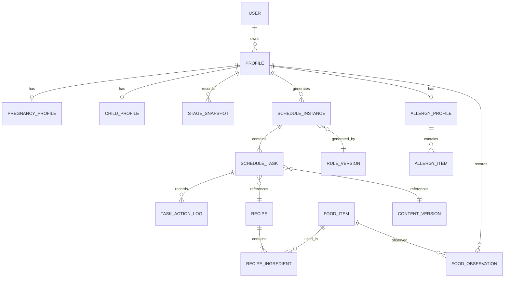

# 02-data-model.md

# 食刻 — 一期数据模型 Spec

| 文档属性     | 内容                                           |
| ------------ | ---------------------------------------------- |
| 项目名称     | 食刻（孕期与婴幼儿餐食日程助手）               |
| 文档名称     | 一期数据模型 Spec                              |
| 文件路径     | `specs/02-data-model.md`                       |
| 版本         | V1.0                                           |
| 状态         | Draft                                          |
| 对应 PRD     | PRD V1.2                                       |
| 业务依据     | `specs/01-business-flow.md`                    |
| 技术方向     | 微信小程序原生框架 + 微信云开发                |
| 一期目标用户 | 孕 30 周左右孕晚期用户、2 岁左右幼儿主要照护者 |

---

## 1. 文档目的

本文档定义「食刻」一期核心业务数据模型，作为数据库设计、云函数接口、业务规则引擎和内容管理工具的共同依据。

本文档重点解决：

1. 用户与档案之间的数据关系。
2. 孕期与幼儿领域数据如何分别建模。
3. 阶段信息如何保存及追踪。
4. 食谱、食材及内容版本如何管理。
5. 日程实例与任务实例如何关联。
6. 过敏状态、禁忌清单和新食物观察记录如何管理。
7. 用户操作历史如何保存。
8. 安全规则及日程生成结果如何追溯。
9. 如何为后续扩展孕期及 0—36 月龄完整业务预留能力。

### 1.1 设计原则

**原则一：业务实体优先。**

数据模型应反映真实业务概念，不应仅根据页面结构设计数据库表或集合。

**原则二：共享基础能力，保留领域差异。**

孕期和幼儿共享用户、档案、日程、任务等基础能力，但各自保留独立领域数据。

**原则三：内容数据化，规则配置化。**

食谱、食材、适用阶段等作为内容数据管理；阶段识别、安全过滤和日程生成作为业务规则处理。

**原则四：重要状态可追溯。**

过敏信息修改、任务替换、日程调整、内容版本变化等操作必须保留必要历史记录。

**原则五：安全约束不可绕过。**

用户偏好、手动选择和任务替换不能覆盖安全规则。

**原则六：允许信息缺失。**

非必要信息允许为空或暂不设置。不得为了满足数据库字段完整性而强制用户填写不必要的信息。

**原则七：一期可实现，后续可扩展。**

不为尚未确定的复杂业务提前设计大量抽象层，但应避免一期数据结构阻碍后续阶段扩展。

---

## 2. 数据模型整体架构

### 2.1 领域划分

建议划分为六个业务域：

| 业务域       | 主要实体                                                 | 职责                         |
| ------------ | -------------------------------------------------------- | ---------------------------- |
| 用户与档案域 | User、Profile                                            | 用户身份及业务档案           |
| 阶段管理域   | PregnancyProfile、ChildProfile、StageSnapshot            | 孕期及幼儿阶段识别           |
| 内容管理域   | FoodItem、Recipe、RecipeIngredient                       | 食材及食谱内容               |
| 日程执行域   | ScheduleInstance、ScheduleTask、TaskActionLog            | 日程生成及执行               |
| 安全管理域   | AllergyProfile、AllergyItem、FoodObservation、SafetyRule | 过敏约束、观察记录及安全规则 |
| 系统追溯域   | RuleVersion、ContentVersion、BusinessEvent               | 规则、内容版本及业务事件     |

### 2.2 实体关系总览



说明：

- 上图描述逻辑关系，不代表数据库必须采用关系型数据库。
- 微信云数据库可以通过集合及引用 ID 实现。
- `Profile` 是业务档案的统一入口。
- `PregnancyProfile` 和 `ChildProfile` 分别保存领域特有信息。
- 日程及任务必须关联生成时使用的内容版本和规则版本。
- 观察记录和过敏信息必须归属于具体幼儿档案，不能仅关联用户账号。

### 2.3 一期实体清单

| 实体             | 是否一期必须 | 说明               |
| ---------------- | ------------ | ------------------ |
| User             | 是           | 用户基础信息       |
| Profile          | 是           | 统一档案           |
| PregnancyProfile | 是           | 孕期领域信息       |
| ChildProfile     | 是           | 幼儿领域信息       |
| StageSnapshot    | 是           | 阶段识别历史       |
| FoodItem         | 是           | 标准食材           |
| Recipe           | 是           | 标准食谱           |
| RecipeIngredient | 是           | 食谱食材及用量关系 |
| ScheduleInstance | 是           | 日程实例           |
| ScheduleTask     | 是           | 日程任务           |
| TaskActionLog    | 是           | 任务操作历史       |
| AllergyProfile   | 是           | 幼儿过敏信息状态   |
| AllergyItem      | 是           | 已知过敏食物清单   |
| FoodObservation  | 是           | 新食物观察记录     |
| SafetyRule       | 是           | 安全规则           |
| RuleVersion      | 是           | 规则版本           |
| ContentVersion   | 是           | 内容版本           |
| BusinessEvent    | 是           | 业务事件           |

注：部分实体在一期可以由受控后台或初始化数据维护，不要求全部建设成独立管理页面。

---

## 3. 用户与档案模型

### 3.1 User 用户实体

用途：表示微信小程序用户身份。

建议字段：

| 字段           | 类型     | 必填 | 说明         |
| -------------- | -------- | ---- | ------------ |
| `_id`          | string   | 是   | 用户唯一 ID  |
| `openid`       | string   | 是   | 微信用户标识 |
| `status`       | string   | 是   | 用户状态     |
| `createdAt`    | datetime | 是   | 创建时间     |
| `updatedAt`    | datetime | 是   | 更新时间     |
| `lastActiveAt` | datetime | 否   | 最近活跃时间 |

状态：

| 状态 | 标识       | 说明         |
| ---- | ---------- | ------------ |
| 正常 | `active`   | 正常使用     |
| 停用 | `disabled` | 禁止继续使用 |

约束：

1. `openid` 必须唯一。
2. 不应将微信身份信息和业务档案混合存储。
3. 不在 User 中直接保存孕周、出生日期、过敏清单等领域数据。
4. 用户删除或停用涉及的具体数据处理，应遵循后续隐私与数据生命周期规范。

### 3.2 Profile 统一档案实体

用途：表示用户创建的一个业务档案。

一个 User 可以拥有多个 Profile。

一期允许简化档案切换交互，但底层必须支持多档案。

建议字段：

| 字段                  | 类型     | 必填 | 说明             |
| --------------------- | -------- | ---- | ---------------- |
| `_id`                 | string   | 是   | 档案唯一 ID      |
| `userId`              | string   | 是   | 所属用户 ID      |
| `profileType`         | string   | 是   | 档案类型         |
| `displayName`         | string   | 否   | 档案展示名称     |
| `status`              | string   | 是   | 档案状态         |
| `currentStageCode`    | string   | 否   | 当前阶段编码     |
| `currentStageVersion` | string   | 否   | 当前阶段规则版本 |
| `createdAt`           | datetime | 是   | 创建时间         |
| `updatedAt`           | datetime | 是   | 更新时间         |
| `archivedAt`          | datetime | 否   | 归档时间         |

`profileType`：

- `pregnancy`
- `child`

`status`：

- `draft`
- `active`
- `paused`
- `archived`

约束：

1. `userId` 必须关联有效 User。
2. `profileType` 创建后原则上不可直接修改。
3. 孕期档案必须关联 PregnancyProfile。
4. 幼儿档案必须关联 ChildProfile。
5. 档案归档不等于物理删除。
6. 不同档案的数据必须严格隔离。
7. 查询和写入业务数据时，必须校验当前用户是否拥有该档案。

### 3.3 PregnancyProfile 孕期领域实体

用途：保存孕期特有信息。

建议字段：

| 字段                    | 类型     | 必填     | 说明               |
| ----------------------- | -------- | -------- | ------------------ |
| `_id`                   | string   | 是       | 领域记录 ID        |
| `profileId`             | string   | 是       | 关联 Profile       |
| `dueDate`               | date     | 条件必填 | 预产期             |
| `gestationalAgeWeeks`   | number   | 否       | 最近计算孕周       |
| `gestationalAgeDays`    | number   | 否       | 孕周内天数         |
| `dateCalculationSource` | string   | 否       | 日期信息来源       |
| `dietPreferences`       | array    | 否       | 饮食偏好           |
| `dietRestrictions`      | array    | 否       | 已知饮食约束       |
| `specialConditions`     | array    | 否       | 用户声明的特殊情况 |
| `createdAt`             | datetime | 是       | 创建时间           |
| `updatedAt`             | datetime | 是       | 更新时间           |

说明：

1. 预产期及孕周相关字段需要明确日期计算口径。
2. `gestationalAgeWeeks` 和 `gestationalAgeDays` 是计算结果，不应作为唯一事实来源。
3. 用户修改日期信息后，需要重新计算阶段。
4. `dateCalculationSource` 应记录日期来源，例如用户填写或其他经确认的数据来源。
5. 特殊情况属于用户声明，不代表系统进行医学诊断。
6. 未经专业审核的特殊情况不能直接形成自动推荐规则。

建议 `dateCalculationSource` 枚举：

- `user_input`
- `professional_record`
- `other`

具体是否支持其他来源，需要在产品流程中确认。

### 3.4 ChildProfile 幼儿领域实体

用途：保存幼儿特有信息。

建议字段：

| 字段               | 类型     | 必填 | 说明         |
| ------------------ | -------- | ---- | ------------ |
| `_id`              | string   | 是   | 领域记录 ID  |
| `profileId`        | string   | 是   | 关联 Profile |
| `birthDate`        | date     | 是   | 出生日期     |
| `ageMonths`        | number   | 否   | 最近计算月龄 |
| `ageDays`          | number   | 否   | 月龄内天数   |
| `dietPreferences`  | array    | 否   | 饮食偏好     |
| `dietRestrictions` | array    | 否   | 已知饮食约束 |
| `feedingNotes`     | string   | 否   | 其他喂养说明 |
| `createdAt`        | datetime | 是   | 创建时间     |
| `updatedAt`        | datetime | 是   | 更新时间     |

约束：

1. 出生日期是年龄计算的基础数据。
2. `ageMonths` 和 `ageDays` 是计算结果，不应作为唯一事实来源。
3. 月龄计算必须采用明确的日期口径。
4. 不得简单将出生天数除以 30 得出月龄。
5. 幼儿年龄变化时，需要重新执行阶段识别。
6. 不将照护者填写的普通说明自动识别为医学诊断。

### 3.5 Profile 与领域实体关系

```text
User
  |
  +---- Profile (pregnancy)
  |          |
  |          +---- PregnancyProfile
  |
  +---- Profile (child)
             |
             +---- ChildProfile
```

设计要求：

- `Profile` 负责统一档案管理。
- `PregnancyProfile` 只保存孕期领域信息。
- `ChildProfile` 只保存幼儿领域信息。
- 不建议把所有领域字段全部堆放在 Profile 中。
- 业务代码通过 `profileType` 分发到对应领域服务。

---

## 4. 阶段管理模型

### 4.1 StageSnapshot 阶段快照

用途：记录档案在某一时刻识别出的阶段信息。

建议字段：

| 字段                 | 类型     | 必填 | 说明         |
| -------------------- | -------- | ---- | ------------ |
| `_id`                | string   | 是   | 记录 ID      |
| `profileId`          | string   | 是   | 档案 ID      |
| `profileType`        | string   | 是   | 档案类型     |
| `stageCode`          | string   | 是   | 阶段编码     |
| `stageName`          | string   | 是   | 阶段名称     |
| `stageStartAt`       | date     | 否   | 阶段起始时间 |
| `stageEndAt`         | date     | 否   | 阶段结束时间 |
| `calculatedAt`       | datetime | 是   | 计算时间     |
| `sourceDataSnapshot` | object   | 是   | 计算依据快照 |
| `stageRuleVersion`   | string   | 是   | 阶段规则版本 |
| `isCurrent`          | boolean  | 是   | 是否当前阶段 |

用途：

- 追踪阶段变化。
- 解释某次日程生成时使用的阶段。
- 处理阶段变化后的日程重新校验。
- 支持后续阶段规则调整。

### 4.2 阶段编码

阶段编码应采用可配置方式，不应将所有阶段边界写死在业务代码中。

建议示例：

孕期：

- `pregnancy_late`

幼儿：

- `child_toddler`

以上仅为一期领域编码建议。具体阶段边界、名称和适用范围需要由产品及专业审核确认。

### 4.3 阶段快照约束

1. 每个档案在同一计算时点只能有一个当前阶段。
2. 阶段变化时，保留旧快照。
3. 新快照必须记录规则版本。
4. 日程实例必须记录生成时对应的阶段快照。
5. 阶段变化不能静默覆盖历史日程的生成依据。

---

## 5. 内容模型

### 5.1 内容模型整体关系

```text
FoodItem 食材
    |
    | 1:N
    v
RecipeIngredient 食谱食材关系
    ^
    | N:1
Recipe 食谱
    |
    +---- ContentVersion 内容版本
```

内容管理的核心要求：

- 食材和食谱分开管理。
- 食谱通过 RecipeIngredient 关联多个食材。
- 食谱内容需要支持版本管理。
- 食谱需要明确适用阶段。
- 安全相关标签必须有明确的数据来源和审核记录。
- 不得使用未经核验的营养数据进行精确营养计算。

### 5.2 FoodItem 食材实体

用途：维护标准食材信息。

建议字段：

| 字段               | 类型     | 必填 | 说明                   |
| ------------------ | -------- | ---- | ---------------------- |
| `_id`              | string   | 是   | 食材 ID                |
| `name`             | string   | 是   | 食材名称               |
| `aliases`          | array    | 否   | 别名                   |
| `categoryCode`     | string   | 是   | 食材分类               |
| `allergenCodes`    | array    | 否   | 已审核的过敏原分类标签 |
| `textureTags`      | array    | 否   | 质地标签               |
| `status`           | string   | 是   | 内容状态               |
| `sourceReferences` | array    | 否   | 来源依据               |
| `createdAt`        | datetime | 是   | 创建时间               |
| `updatedAt`        | datetime | 是   | 更新时间               |

说明：

1. `allergenCodes` 不能只根据食材名称自动推断。
2. 标签应来自经过审核的食材资料。
3. 食材分类、过敏原分类及质地标签应采用标准字典。
4. 未知信息应允许为空，不得默认填充。
5. 食材基础信息与具体食谱中的使用方式分开管理。

### 5.3 Recipe 食谱实体

用途：维护经过审核的标准食谱。

建议字段：

| 字段                     | 类型     | 必填 | 说明                       |
| ------------------------ | -------- | ---- | -------------------------- |
| `_id`                    | string   | 是   | 食谱 ID                    |
| `recipeCode`             | string   | 是   | 业务唯一编码               |
| `name`                   | string   | 是   | 食谱名称                   |
| `description`            | string   | 否   | 食谱简介                   |
| `mealType`               | string   | 是   | 餐次类型                   |
| `applicableProfileTypes` | array    | 是   | 适用档案类型               |
| `applicableStageCodes`   | array    | 是   | 适用阶段                   |
| `ingredients`            | array    | 否   | 食材关系引用或冗余展示数据 |
| `preparationSteps`       | array    | 否   | 制作步骤                   |
| `nutritionData`          | object   | 否   | 营养数据                   |
| `textureTags`            | array    | 否   | 质地标签                   |
| `difficulty`             | string   | 否   | 制作难度                   |
| `sceneTags`              | array    | 否   | 场景标签                   |
| `status`                 | string   | 是   | 内容状态                   |
| `currentVersionId`       | string   | 是   | 当前发布版本               |
| `createdAt`              | datetime | 是   | 创建时间                   |
| `updatedAt`              | datetime | 是   | 更新时间                   |

`mealType` 建议支持配置：

- `breakfast`
- `lunch`
- `dinner`
- `snack`
- `other`

具体餐次配置以一期日程规则为准。

`status`：

- `draft`
- `pending_review`
- `approved`
- `published`
- `withdrawn`
- `archived`

业务约束：

1. 只有已审核且已发布的食谱可以进入推荐候选。
2. 被撤回的食谱不能继续进入新日程。
3. 食谱必须明确适用的档案类型和阶段。
4. 幼儿食谱必须具备相应的质地及阶段适配审核信息。
5. 营养数据允许部分缺失。
6. 未经核验的营养数据不得用于精确营养计算。
7. 已发布内容发生重要修改时，应创建新版本，不直接覆盖历史版本。

### 5.4 RecipeIngredient 食谱食材关系

用途：描述一个食谱使用了哪些食材及其用量。

建议字段：

| 字段                | 类型    | 必填 | 说明         |
| ------------------- | ------- | ---- | ------------ |
| `_id`               | string  | 是   | 关系记录 ID  |
| `recipeId`          | string  | 是   | 食谱 ID      |
| `foodItemId`        | string  | 是   | 食材 ID      |
| `quantity`          | number  | 否   | 用量         |
| `unit`              | string  | 否   | 用量单位     |
| `preparationMethod` | string  | 否   | 食材处理方式 |
| `isMainIngredient`  | boolean | 否   | 是否主要食材 |
| `sortOrder`         | number  | 否   | 展示顺序     |

约束：

- 食材必须关联有效 FoodItem。
- 用量和单位必须成对校验。
- 未知用量允许为空。
- 不允许用默认值伪造实际用量。
- 食谱发布时需要校验食材关系完整性。

### 5.5 NutritionData 营养数据

建议采用结构化对象。

字段示例：

| 字段               | 类型          | 说明       |
| ------------------ | ------------- | ---------- |
| `energyKcal`       | number/null   | 能量       |
| `proteinG`         | number/null   | 蛋白质     |
| `fatG`             | number/null   | 脂肪       |
| `carbohydrateG`    | number/null   | 碳水化合物 |
| `fiberG`           | number/null   | 膳食纤维   |
| `sodiumMg`         | number/null   | 钠         |
| `calculationBasis` | string        | 计算依据   |
| `dataSource`       | string        | 数据来源   |
| `verifiedAt`       | datetime/null | 核验时间   |

说明：

1. 上述字段是数据结构建议，不代表一期必须采集全部指标。
2. 未核验的数据应为 null。
3. 必须明确数据对应的份量或计量基准。
4. 不同食谱的营养数据不能在计量基准不一致时直接比较。
5. 一期是否开展营养定量计算，需要在日程规则 Spec 中确认。

### 5.6 ContentVersion 内容版本

用途：保证历史日程引用的食谱内容可追溯。

建议字段：

| 字段            | 类型     | 必填 | 说明         |
| --------------- | -------- | ---- | ------------ |
| `_id`           | string   | 是   | 内容版本 ID  |
| `contentType`   | string   | 是   | 内容类型     |
| `contentId`     | string   | 是   | 原始内容 ID  |
| `version`       | string   | 是   | 版本号       |
| `snapshot`      | object   | 是   | 版本内容快照 |
| `reviewStatus`  | string   | 是   | 审核状态     |
| `reviewerId`    | string   | 否   | 审核人       |
| `reviewedAt`    | datetime | 否   | 审核时间     |
| `effectiveAt`   | datetime | 否   | 生效时间     |
| `expiresAt`     | datetime | 否   | 失效时间     |
| `changeSummary` | string   | 否   | 版本变更说明 |
| `createdAt`     | datetime | 是   | 创建时间     |

约束：

1. 已发布版本不可直接覆盖。
2. 新版本必须重新执行必要审核。
3. 历史日程引用具体版本 ID。
4. 内容撤回时，应记录撤回原因和时间。
5. 内容版本快照需要包含当时的适用阶段、食材及关键安全标签。

---

## 6. 日程与任务模型

### 6.1 ScheduleInstance 日程实例

用途：表示某个档案在某一天的一份日程。

建议字段：

| 字段                 | 类型     | 必填 | 说明                   |
| -------------------- | -------- | ---- | ---------------------- |
| `_id`                | string   | 是   | 日程 ID                |
| `profileId`          | string   | 是   | 档案 ID                |
| `profileType`        | string   | 是   | 档案类型               |
| `scheduleDate`       | date     | 是   | 日程日期               |
| `stageSnapshotId`    | string   | 是   | 阶段快照 ID            |
| `status`             | string   | 是   | 日程状态               |
| `generationId`       | string   | 是   | 本次生成批次 ID        |
| `generationSource`   | string   | 是   | 生成来源               |
| `ruleVersionId`      | string   | 是   | 规则版本               |
| `contentVersionRefs` | array    | 是   | 本次生成使用的内容版本 |
| `profileSnapshot`    | object   | 是   | 生成时档案约束快照     |
| `generatedAt`        | datetime | 是   | 生成时间               |
| `updatedAt`          | datetime | 是   | 更新时间               |

`generationSource` 建议：

- `initial`
- `scheduled`
- `regenerated`
- `manual_adjustment`

说明：

1. 一份日程对应一个档案和一个日期。
2. 日程必须记录生成时的阶段及规则版本。
3. 日程生成结果需要可重复追溯。
4. 日程重新生成不能直接覆盖历史操作记录。
5. 一期未来 7 天日程需要通过多个日期的日程实例实现。
6. `profileSnapshot` 只保存生成决策所需的最小必要信息，不复制整个用户档案。

### 6.2 ScheduleTask 日程任务

用途：表示日程中的一个具体执行任务。

建议字段：

| 字段                | 类型     | 必填 | 说明             |
| ------------------- | -------- | ---- | ---------------- |
| `_id`               | string   | 是   | 任务 ID          |
| `scheduleId`        | string   | 是   | 所属日程 ID      |
| `profileId`         | string   | 是   | 所属档案 ID      |
| `taskCode`          | string   | 是   | 任务业务编码     |
| `mealType`          | string   | 是   | 餐次类型         |
| `recipeId`          | string   | 否   | 当前关联食谱 ID  |
| `contentVersionId`  | string   | 否   | 当前食谱版本 ID  |
| `status`            | string   | 是   | 任务状态         |
| `plannedAt`         | datetime | 否   | 计划执行时间     |
| `deferredTo`        | datetime | 否   | 顺延后的执行时间 |
| `completedAt`       | datetime | 否   | 完成时间         |
| `originalRecipeId`  | string   | 否   | 最初推荐食谱     |
| `replacementCount`  | number   | 是   | 替换次数         |
| `safetyCheckStatus` | string   | 是   | 最近安全校验状态 |
| `createdAt`         | datetime | 是   | 创建时间         |
| `updatedAt`         | datetime | 是   | 更新时间         |

`status`：

- `pending`
- `completed`
- `skipped`
- `replaced`
- `deferred`
- `cancelled`
- `invalidated`

说明：

1. 任务必须关联所属日程和档案。
2. 替换操作必须保留原始推荐内容。
3. 当前食谱版本需要明确记录。
4. 任务安全校验结果需要可追溯。
5. 被失效的任务不能继续作为有效推荐执行。
6. 用户完成任务需要明确操作确认。
7. 不应将页面浏览直接写入完成状态。

### 6.3 TaskActionLog 任务操作历史

用途：记录任务生命周期中的操作。

建议字段：

| 字段               | 类型     | 必填 | 说明        |
| ------------------ | -------- | ---- | ----------- |
| `_id`              | string   | 是   | 操作记录 ID |
| `taskId`           | string   | 是   | 任务 ID     |
| `scheduleId`       | string   | 是   | 日程 ID     |
| `profileId`        | string   | 是   | 档案 ID     |
| `actionType`       | string   | 是   | 操作类型    |
| `previousStatus`   | string   | 否   | 操作前状态  |
| `nextStatus`       | string   | 否   | 操作后状态  |
| `previousRecipeId` | string   | 否   | 操作前食谱  |
| `nextRecipeId`     | string   | 否   | 操作后食谱  |
| `reason`           | string   | 否   | 操作原因    |
| `operatorType`     | string   | 是   | 操作者类型  |
| `createdAt`        | datetime | 是   | 操作时间    |

`actionType` 建议：

- `complete`
- `skip`
- `replace`
- `defer`
- `cancel`
- `invalidate`
- `restore`

`operatorType`：

- `user`
- `system`
- `admin`

约束：

- 操作历史原则上只追加，不直接覆盖。
- 用户操作和系统操作需要区分。
- 替换记录必须包含原始和新食谱 ID。
- 安全规则导致任务失效时，需要记录对应原因。
- 历史记录必须关联正确的档案 ID。

---

## 7. 过敏及新食物观察模型

### 7.1 AllergyProfile 过敏信息档案

用途：保存幼儿档案当前的过敏信息状态。

建议字段：

| 字段                | 类型     | 必填 | 说明             |
| ------------------- | -------- | ---- | ---------------- |
| `_id`               | string   | 是   | 记录 ID          |
| `profileId`         | string   | 是   | 幼儿档案 ID      |
| `status`            | string   | 是   | 当前过敏信息状态 |
| `informationSource` | string   | 否   | 信息来源         |
| `declaredAt`        | datetime | 否   | 用户声明时间     |
| `updatedAt`         | datetime | 是   | 更新时间         |
| `updatedBy`         | string   | 是   | 修改来源         |

状态：

- `none_known`
- `confirmed_allergy`
- `observing`
- `skipped`

说明：

1. `AllergyProfile` 记录当前状态。
2. 具体过敏食物由 AllergyItem 保存。
3. `none_known` 只表示用户声明目前没有已知食物过敏。
4. `skipped` 表示用户暂时不设置。
5. 不得将 `skipped` 自动转换为 `none_known`。
6. 用户修改状态时需要保留历史记录。
7. `observing` 表示存在观察行为，不代表医学上确诊或排除过敏。

`informationSource` 建议：

- `user_declaration`
- `professional_record`
- `other`

如果涉及专业记录，应保留必要的来源说明及核验信息，但不应默认要求用户上传完整医疗资料。

### 7.2 AllergyItem 已知过敏食物

用途：保存用户声明的已知过敏食物及对应信息。

建议字段：

| 字段               | 类型     | 必填     | 说明            |
| ------------------ | -------- | -------- | --------------- |
| `_id`              | string   | 是       | 记录 ID         |
| `profileId`        | string   | 是       | 幼儿档案 ID     |
| `allergyProfileId` | string   | 是       | 过敏信息档案 ID |
| `foodItemId`       | string   | 条件必填 | 标准食材 ID     |
| `foodName`         | string   | 条件必填 | 食物名称        |
| `declarationType`  | string   | 是       | 信息类型        |
| `source`           | string   | 否       | 信息来源        |
| `status`           | string   | 是       | 当前记录状态    |
| `notes`            | string   | 否       | 补充说明        |
| `createdAt`        | datetime | 是       | 创建时间        |
| `updatedAt`        | datetime | 是       | 更新时间        |

`declarationType`：

- `user_reported`
- `professionally_confirmed`

说明：

- `professionally_confirmed` 只能在有相应专业依据时使用。
- 用户自行声明不能被系统自动升级为专业确认。
- 食物名称允许暂时使用文本记录，但应尽量关联标准 FoodItem。
- 已知禁忌的生效状态必须能够被安全过滤模块读取。

`status`：

- `active`
- `inactive`

停用记录应保留历史，不直接物理删除。

### 7.3 FoodObservation 新食物观察记录

用途：保存幼儿尝试新食物及后续观察信息。

建议字段：

| 字段                  | 类型     | 必填 | 说明         |
| --------------------- | -------- | ---- | ------------ |
| `_id`                 | string   | 是   | 观察记录 ID  |
| `profileId`           | string   | 是   | 幼儿档案 ID  |
| `foodItemId`          | string   | 否   | 标准食材 ID  |
| `foodName`            | string   | 是   | 食物名称     |
| `attemptedAt`         | datetime | 是   | 尝试时间     |
| `consumptionStatus`   | string   | 是   | 食用情况     |
| `observationStatus`   | string   | 是   | 观察结果     |
| `reactionDescription` | string   | 否   | 反应描述     |
| `reactionOccurredAt`  | datetime | 否   | 反应发生时间 |
| `recordedAt`          | datetime | 是   | 记录时间     |
| `createdAt`           | datetime | 是   | 创建时间     |
| `updatedAt`           | datetime | 是   | 更新时间     |

`consumptionStatus` 建议：

- `consumed`
- `partially_consumed`
- `not_consumed`
- `unknown`

`observationStatus` 建议：

- `no_obvious_reaction_recorded`
- `suspected_reaction`
- `not_observed`
- `unknown`

注意：

`no_obvious_reaction_recorded` 仅表示用户记录中没有发现明显反应，不代表医学上确认不过敏。

业务约束：

1. 一条观察记录对应一次具体尝试。
2. 用户可以补充观察信息。
3. 不允许自动将观察结果转换为医学诊断。
4. 疑似反应记录需要触发相应安全处理。
5. 疑似反应后应停止该食物自动安排。
6. 不自动安排未来再次尝试。
7. 观察记录与已知过敏清单是不同实体，不能互相替代。

### 7.4 过敏信息变更历史

建议增加 `AllergyChangeLog`，用于记录过敏状态及禁忌清单变化。

字段：

| 字段             | 类型     | 必填 | 说明        |
| ---------------- | -------- | ---- | ----------- |
| `_id`            | string   | 是   | 记录 ID     |
| `profileId`      | string   | 是   | 幼儿档案 ID |
| `previousStatus` | string   | 否   | 修改前状态  |
| `nextStatus`     | string   | 是   | 修改后状态  |
| `changeType`     | string   | 是   | 变更类型    |
| `changedItems`   | array    | 否   | 变化的食物  |
| `source`         | string   | 是   | 变更来源    |
| `createdAt`      | datetime | 是   | 变更时间    |

变更后必须触发未来未执行日程的安全校验。

---

## 8. 安全规则及版本模型

### 8.1 SafetyRule 安全规则实体

用途：存储经过审核的安全规则。

建议字段：

| 字段                     | 类型     | 必填 | 说明         |
| ------------------------ | -------- | ---- | ------------ |
| `_id`                    | string   | 是   | 规则 ID      |
| `ruleCode`               | string   | 是   | 规则编码     |
| `ruleType`               | string   | 是   | 规则类型     |
| `severity`               | string   | 是   | 风险等级     |
| `applicableProfileTypes` | array    | 是   | 适用档案类型 |
| `applicableStageCodes`   | array    | 否   | 适用阶段     |
| `condition`              | object   | 是   | 触发条件     |
| `action`                 | object   | 是   | 触发动作     |
| `sourceReferences`       | array    | 是   | 来源依据     |
| `reviewStatus`           | string   | 是   | 审核状态     |
| `ruleVersionId`          | string   | 是   | 规则版本     |
| `effectiveAt`            | datetime | 是   | 生效时间     |
| `expiresAt`              | datetime | 否   | 失效时间     |
| `createdAt`              | datetime | 是   | 创建时间     |
| `updatedAt`              | datetime | 是   | 更新时间     |

建议风险等级：

- `S1`
- `S2`
- `S3`

此分级为产品内部规则管理建议，不代表官方临床风险分级。

规则类型建议：

- `allergy`
- `stage`
- `texture`
- `diet_restriction`
- `special_condition`
- `content_withdrawal`

`reviewStatus`：

- `draft`
- `pending_review`
- `approved`
- `published`
- `withdrawn`

### 8.2 RuleVersion 规则版本

用途：记录规则发布版本。

建议字段：

| 字段            | 类型     | 必填 | 说明        |
| --------------- | -------- | ---- | ----------- |
| `_id`           | string   | 是   | 规则版本 ID |
| `ruleSetCode`   | string   | 是   | 规则集编码  |
| `version`       | string   | 是   | 版本号      |
| `snapshot`      | object   | 是   | 规则快照    |
| `reviewerId`    | string   | 否   | 审核人      |
| `reviewedAt`    | datetime | 否   | 审核时间    |
| `effectiveAt`   | datetime | 是   | 生效时间    |
| `status`        | string   | 是   | 版本状态    |
| `changeSummary` | string   | 否   | 修改说明    |
| `createdAt`     | datetime | 是   | 创建时间    |

约束：

1. 已发布规则版本不可直接覆盖。
2. 规则变更必须生成新版本。
3. 日程实例必须记录生成时使用的规则版本。
4. 规则版本应能够独立回溯。
5. 未审核规则不得参与生产推荐。
6. 规则变更后是否需要重新校验历史未来日程，应根据规则影响范围确定。

---

## 9. 业务事件模型

### 9.1 BusinessEvent

用途：记录一期核心业务行为。

建议字段：

| 字段          | 类型     | 必填 | 说明           |
| ------------- | -------- | ---- | -------------- |
| `_id`         | string   | 是   | 事件 ID        |
| `eventName`   | string   | 是   | 事件名称       |
| `userId`      | string   | 是   | 用户 ID        |
| `profileId`   | string   | 否   | 档案 ID        |
| `profileType` | string   | 否   | 档案类型       |
| `targetId`    | string   | 否   | 业务对象 ID    |
| `targetType`  | string   | 否   | 业务对象类型   |
| `properties`  | object   | 否   | 非敏感事件属性 |
| `occurredAt`  | datetime | 是   | 事件发生时间   |
| `createdAt`   | datetime | 是   | 入库时间       |

一期核心事件：

- `profile_created`
- `schedule_generated`
- `schedule_viewed`
- `task_completed`
- `task_skipped`
- `recipe_replaced`
- `recipe_viewed`
- `schedule_deferred`
- `stage_changed`
- `allergy_status_updated`
- `food_observation_created`
- `safety_rule_triggered`

### 9.2 事件采集约束

1. 事件记录应与核心业务操作区分。
2. 核心业务数据不能只依赖埋点记录。
3. 事件属性遵循最小必要原则。
4. 不在普通分析事件中携带不必要的健康信息。
5. 孕期和幼儿场景应能够独立分析。
6. 事件重复上报需要考虑幂等处理。

---

## 10. 关键实体关系与数据一致性

### 10.1 档案数据隔离

所有档案相关业务数据必须带有 `profileId`。

至少包括：

- 阶段快照。
- 日程实例。
- 日程任务。
- 任务操作记录。
- 过敏信息。
- 已知过敏食物。
- 新食物观察记录。

服务端必须校验：

`profile.userId === currentUser.id`

不能仅依赖客户端传入的 `profileId` 判断数据访问权限。

### 10.2 日程生成一致性

日程生成时需要保存：

- 档案 ID。
- 阶段快照 ID。
- 规则版本 ID。
- 内容版本 ID。
- 档案约束快照。
- 生成批次 ID。
- 生成时间。

以上数据用于回答：

1. 为什么生成这份日程？
2. 生成时用户处于什么阶段？
3. 使用了哪些食谱版本？
4. 执行了哪些规则？
5. 当时有哪些用户约束？

### 10.3 任务操作一致性

任务操作应保证：

1. 状态变更与操作日志保持一致。
2. 替换内容必须通过安全校验。
3. 任务不能在无效状态下继续完成。
4. 同一个操作不能因重复请求而重复产生业务结果。
5. 操作日志保留历史状态及关键内容变化。

### 10.4 过敏信息一致性

过敏信息变更必须：

1. 更新当前 AllergyProfile。
2. 更新对应 AllergyItem。
3. 记录 AllergyChangeLog。
4. 触发未来未执行任务重新校验。
5. 保存重新校验结果。
6. 无合适替代内容时允许任务暂缺。

### 10.5 内容版本一致性

食谱发布后：

- 新版本不能覆盖旧版本。
- 已生成任务引用具体内容版本。
- 内容撤回后需要重新校验未来未执行任务。
- 历史任务保留生成时内容快照或可访问的不可变版本。

---

## 11. 微信云数据库集合建议

以下是逻辑集合划分建议，不代表必须完全按照此命名落地。

| 集合名称              | 对应实体         | 说明             |
| --------------------- | ---------------- | ---------------- |
| `users`               | User             | 用户             |
| `profiles`            | Profile          | 档案             |
| `pregnancy_profiles`  | PregnancyProfile | 孕期信息         |
| `child_profiles`      | ChildProfile     | 幼儿信息         |
| `stage_snapshots`     | StageSnapshot    | 阶段快照         |
| `food_items`          | FoodItem         | 食材             |
| `recipes`             | Recipe           | 食谱             |
| `recipe_ingredients`  | RecipeIngredient | 食谱食材关系     |
| `content_versions`    | ContentVersion   | 内容版本         |
| `schedule_instances`  | ScheduleInstance | 日程实例         |
| `schedule_tasks`      | ScheduleTask     | 日程任务         |
| `task_action_logs`    | TaskActionLog    | 任务操作记录     |
| `allergy_profiles`    | AllergyProfile   | 过敏信息         |
| `allergy_items`       | AllergyItem      | 已知过敏食物     |
| `food_observations`   | FoodObservation  | 新食物观察       |
| `allergy_change_logs` | AllergyChangeLog | 过敏信息变更历史 |
| `safety_rules`        | SafetyRule       | 安全规则         |
| `rule_versions`       | RuleVersion      | 规则版本         |
| `business_events`     | BusinessEvent    | 业务事件         |

### 11.1 是否需要拆分集合

不要求所有逻辑实体都必须单独建立集合。

实际实现时应结合：

- 查询模式。
- 数据规模。
- 更新频率。
- 微信云数据库单次查询和事务能力。
- 数据权限要求。
- 规则执行方式。

例如：

- `RecipeIngredient` 可以独立集合，也可以在食谱版本快照中嵌套保存。
- `AllergyItem` 如果数量较少，也可以嵌入 AllergyProfile，但必须确保能够独立进行安全过滤和更新。
- `TaskActionLog` 建议独立保存，以便保留操作历史。
- `ContentVersion` 和 `RuleVersion` 建议独立保存，避免发布版本被覆盖。

最终物理集合设计应在技术架构 Spec 中结合实际查询场景确定。

---

## 12. 索引与查询需求

一期至少需要考虑以下查询。

| 集合               | 查询场景             | 建议索引字段                    |
| ------------------ | -------------------- | ------------------------------- |
| users              | 根据微信身份查询用户 | `openid`                        |
| profiles           | 查询用户档案         | `userId + status`               |
| pregnancy_profiles | 根据档案查询孕期信息 | `profileId`                     |
| child_profiles     | 根据档案查询幼儿信息 | `profileId`                     |
| stage_snapshots    | 查询当前阶段         | `profileId + isCurrent`         |
| recipes            | 查询可用食谱         | `status + applicableStageCodes` |
| recipes            | 按类型筛选食谱       | `status + mealType`             |
| schedule_instances | 查询某档案某日程     | `profileId + scheduleDate`      |
| schedule_tasks     | 查询日程任务         | `scheduleId + status`           |
| schedule_tasks     | 查询档案未来任务     | `profileId + plannedAt`         |
| task_action_logs   | 查询任务操作历史     | `taskId + createdAt`            |
| allergy_profiles   | 查询档案过敏状态     | `profileId`                     |
| allergy_items      | 查询有效禁忌         | `profileId + status`            |
| food_observations  | 查询观察记录         | `profileId + attemptedAt`       |
| safety_rules       | 查询有效安全规则     | `reviewStatus + effectiveAt`    |
| content_versions   | 查询内容版本         | `contentId + version`           |
| business_events    | 按档案及时间统计     | `profileId + occurredAt`        |

注意：

1. 微信云数据库索引能力及复合索引限制需要在实现时核对当前平台文档。
2. 不应仅根据字段清单机械创建所有索引。
3. 索引设计需要结合实际查询和数据量。
4. 云数据库查询权限不能代替业务层权限校验。

---

## 13. 数据生命周期与隐私约束

### 13.1 敏感信息

以下信息需要重点保护：

- 孕期日期及相关信息。
- 幼儿出生日期。
- 已知过敏信息。
- 新食物观察及反应描述。
- 特殊饮食和健康相关说明。

### 13.2 基本要求

1. 只收集完成产品功能所必需的信息。
2. 明确告知信息用途。
3. 严格限制客户端和后台访问权限。
4. 不在日志中输出完整敏感信息。
5. 不默认将敏感信息用于广告画像。
6. 分析数据尽量采用去标识化或聚合方式。
7. 用户修改和删除信息时，需要明确关联数据的处理策略。
8. 对管理员访问敏感信息保留必要审计记录。

### 13.3 删除与归档

需要区分：

- 档案归档。
- 用户主动删除。
- 内容撤回。
- 规则失效。

这些行为不能使用同一种删除逻辑。

具体数据保留期限、用户删除请求处理方式及备份数据处理要求，需要在隐私与合规 Spec 中进一步明确。

---

## 14. 一期数据模型验收标准

### 14.1 用户与档案

- [ ] 一个 User 可以关联多个 Profile。
- [ ] Profile 能区分 `pregnancy` 和 `child`。
- [ ] 孕期和幼儿领域信息独立保存。
- [ ] 不同档案的数据访问相互隔离。
- [ ] 档案归档不直接删除历史数据。

### 14.2 阶段管理

- [ ] 孕期阶段能够根据日期信息计算。
- [ ] 幼儿阶段能够根据出生日期计算。
- [ ] 阶段快照能够保留历史。
- [ ] 阶段快照记录规则版本。
- [ ] 日程能够追溯生成时的阶段。

### 14.3 内容管理

- [ ] 食材和食谱独立管理。
- [ ] 食谱能够关联多个食材。
- [ ] 食谱能够记录适用档案类型和阶段。
- [ ] 食谱能够记录审核状态。
- [ ] 内容版本能够独立追溯。
- [ ] 未核验营养数据允许为空。
- [ ] 被撤回内容不能进入新日程。

### 14.4 日程及任务

- [ ] 日程实例与任务实例分离。
- [ ] 一个日程能够包含多个任务。
- [ ] 任务能够记录当前食谱及版本。
- [ ] 任务替换能够保留原始内容。
- [ ] 任务操作历史能够追溯。
- [ ] 日程能够追溯阶段、规则和内容版本。

### 14.5 过敏及观察

- [ ] `none_known` 和 `skipped` 明确区分。
- [ ] 已知过敏食物能够独立管理。
- [ ] 已知禁忌能够供安全过滤模块读取。
- [ ] 新食物观察记录能够保存多次尝试。
- [ ] 疑似反应记录能够触发安全处理。
- [ ] 观察记录不自动形成医学诊断。
- [ ] 过敏信息变化能够保留历史。

### 14.6 数据安全

- [ ] 档案数据具有明确归属关系。
- [ ] 服务端校验用户与档案的归属关系。
- [ ] 敏感信息不进入不必要的业务日志。
- [ ] 关键操作具有必要审计记录。
- [ ] 业务事件与核心业务数据分离。

---

## 15. 尚待确认事项

以下事项不应由开发人员自行猜测。

| 编号  | 待确认事项                                                           | 影响范围                        | 建议处理阶段    |
| ----- | -------------------------------------------------------------------- | ------------------------------- | --------------- |
| DM-01 | 孕期日期信息采用预产期还是末次月经日期作为主要输入，是否支持其他来源 | PregnancyProfile                | 阶段规则 Spec   |
| DM-02 | 孕期具体孕周计算口径                                                 | PregnancyProfile、StageSnapshot | 阶段规则 Spec   |
| DM-03 | 2 岁左右幼儿的一期月龄边界                                           | ChildProfile、StageSnapshot     | 阶段规则 Spec   |
| DM-04 | 一期食谱营养数据需要采集到什么程度                                   | Recipe                          | 内容 Spec       |
| DM-05 | 食谱内容版本快照保存完整字段还是引用不可变内容                       | ContentVersion                  | 技术架构 Spec   |
| DM-06 | AllergyItem 是否独立集合                                             | AllergyItem                     | 技术架构 Spec   |
| DM-07 | 观察中的食物是否允许进入推荐候选                                     | FoodObservation、SafetyRule     | 安全规则 Spec   |
| DM-08 | 疑似反应后是否自动将食物加入禁忌清单，及其状态表达                   | AllergyItem、FoodObservation    | 安全规则 Spec   |
| DM-09 | 日程重新生成时，已替换任务如何处理                                   | ScheduleInstance、ScheduleTask  | 日程规则 Spec   |
| DM-10 | 顺延任务跨日后是否保留原日程归属                                     | ScheduleTask                    | 日程规则 Spec   |
| DM-11 | 用户删除档案后的关联数据保留策略                                     | 全部档案数据                    | 隐私与合规 Spec |
| DM-12 | 内容审核人及后台操作人员的身份和权限模型                             | ContentVersion、SafetyRule      | 后台 Spec       |

---

## 16. 下一阶段文档

建议继续按照以下顺序推进：

| 顺序 | 文档                         | 目标                               |
| ---- | ---------------------------- | ---------------------------------- |
| 1    | `03-content-spec.md`         | 明确食材、食谱、内容审核和发布标准 |
| 2    | `04-schedule-rules.md`       | 明确未来 7 天日程生成逻辑          |
| 3    | `05-safety-rules.md`         | 明确过敏、安全过滤和风险处理规则   |
| 4    | `06-page-flow.md`            | 明确小程序页面及交互流程           |
| 5    | `07-acceptance-checklist.md` | 形成可测试的验收清单               |

**建议下一步先完成 `03-content-spec.md`。**

原因：

1. 日程引擎依赖标准化食谱数据。
2. 食谱适用阶段和审核状态会影响候选筛选。
3. 食材及过敏原标签会影响安全过滤。
4. 营养数据的完整程度决定日程引擎能够执行哪些匹配规则。

在内容模型和审核流程明确之前，不建议直接实现完整日程推荐算法。

---

**文档结束**
